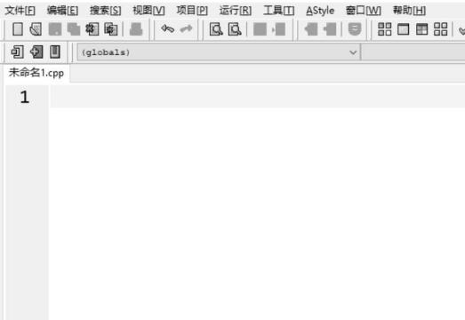
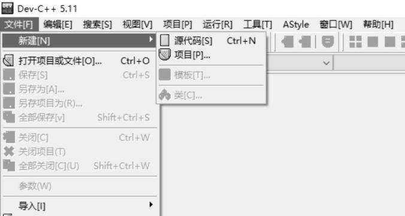
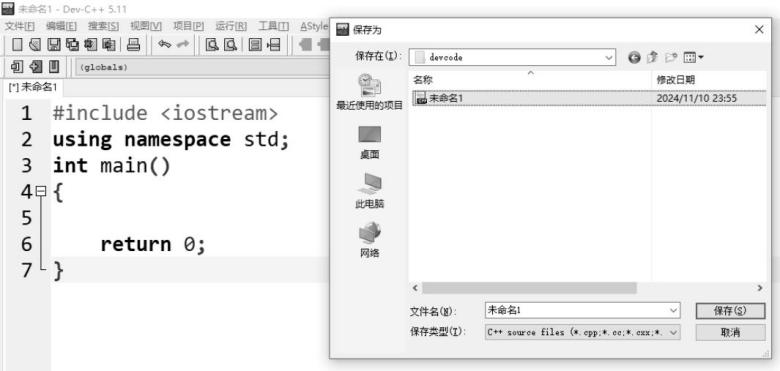
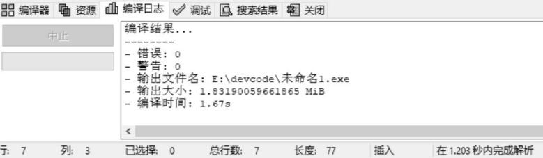
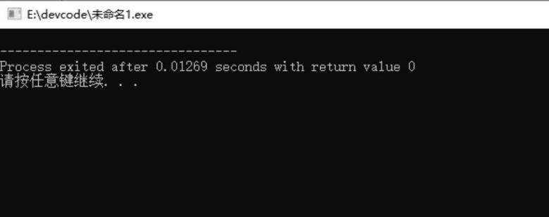
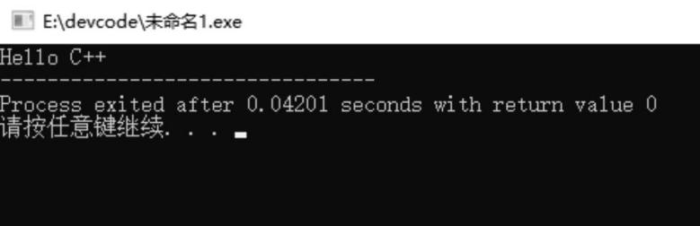
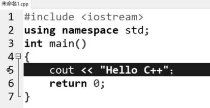
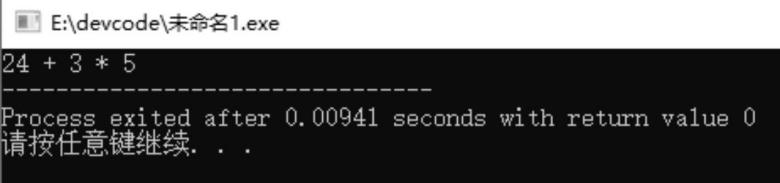

# 第 1 课：程序入门

本章开始学习顺序结构。生活中很多事情的完成都有先后顺序，比如刷牙：

1) 刷牙前：准备好牙刷、牙膏、水杯等工具。

2) 开始刷牙：将牙刷放入口中，充分刷到每一颗牙齿。

3) 刷完牙：用清水漱口，冲洗牙刷并甩干水分，然后放回原处。

除了刷牙的例子外，你还能想到生活中哪些顺序结构的场景呢？

在正式写程序之前，我们先了解一下什么是程序。程序是指一组按照特定顺序和逻辑编写的计算机指令，用来完成某些特定任务或解决某个问题。

举个简单的例子，比如蛙蛙想买包子吃，他首先来到早餐店，然后告诉老板给他来两个香菇青菜馅的包子，这里的"两个""香菇青菜馅的包子"就可以看作给老板下达的"指令"。老板接收到"指令"，递给了蛙蛙两个香菇青菜馅的包子，就解决了蛙蛙买包子这个问题。

而我们现在处于计算机的世界当中，程序需要通过编程语言来编写，然后由计算机去执行。编程语言有很多，比如 Python、Java、C++ 等，由于信息学奥赛的官方比赛语言目前仅支持 C++，所以本书的语法、算法及数据结构均通过 C++ 来实现。

什么是 C++ 呢？又有哪些产品是通过 C++ 开发的呢？让我们一起来了解一下。

## 1.1 C++ 简介

C++ 于 1983 年由比雅尼·斯特劳斯特卢普（Bjarne Stroustrup）在 C 语言的基础上开发出来，由于性能优越、灵活性强，被广泛应用于各个领域。

在操作系统方面，大家常用的 Windows 操作系统，其内核、文件系统等部分大量使用了 C++。信息学奥赛考试用的 Linux 系统，其内核和驱动也使用了 C++。

在游戏开发方面，国产西游主题大型游戏《黑神话：悟空》所使用的游戏引擎——Unreal Engine，它的主要开发语言就是 C++。

有些同学可能接触过 Photoshop 这款图片处理软件，也有些同学可能接触过 3D 建模软件 Blender，这些软件的核心部分均由 C++ 编写。甚至我们常用的谷歌浏览器，也有 C++ 语言的参与。

从这里我们便能看出，C++ 不仅仅是信息学奥赛官方比赛语言，它还能支撑各行各业的应用。它也许会从你现在这个阶段陪伴你到未来很长一段时间，或许能伴随你的一生。

听到这里，蛙蛙已经迫不及待想学习 C++ 这门语言了，让我们跟随蛙蛙进入 C++ 的世界吧。

## 1.2 软件使用

工欲善其事，必先利其器，想要学 C++，必须要先有一个编写 C++ 的开发环境。开发环境 DEV-CPP 的安装教程已经放到我的博客 bigbigli.com/rjxz.html 了，若你还未安装环境，请移步到 bigbigli.com/rjxz.html，安装好后再继续往下进行。

### 1. 新建源程序

**步骤一**：从主菜单中依次选择"文件"→"新建"→"源代码"菜单。新建完成之后，屏幕右下侧出现一片白色区域，称为"源程序编辑区域"，可以在此输入程序，如图 1-1 所示。

图 1-1　新建源程序





**步骤二**：创建 C++ 程序基本框架。把下面这几行代码写进"源程序编辑区域"，之后我再解释这几行代码的意思。

```cpp
#include <iostream>
using namespace std;
int main()
{
    return 0;
}
```

需要注意，这里所有的符号，比如 `<>`、`;`、`()`、`{}` 均为英文状态下的符号。写完之后，再来了解每一行究竟表示什么。

将整个程序比作买菜做饭的场景：现在蛙蛙饿了，他告诉妈妈想吃西红柿炒鸡蛋，但是家里没有食材，于是妈妈先去了一趟菜市场，然后回家给蛙蛙做饭……

- `#include <iostream>`

include 是"包括、包含"的意思，这里包含了一个头文件 iostream。我们可以把头文件比作菜市场，蛙蛙想吃 A 婆婆卖的西红柿，所以妈妈必须要去 A 婆婆所在的菜市场才能买到西红柿，而这里的 iostream 就是有西红柿的菜市场。

iostream 中的 i 表示的是 input，是输入的意思；o 表示的是 output，是输出的意思；stream 是流，流出的意思。一个程序，基本都会有输入和输出，这个头文件的功能就是处理标准输入、标准输出和标准错误等。

- `using namespace std;`

use 是使用的意思，name 是命名的意思，space 是空间的意思，std 是 standard 的缩写，意为标准的。合在一起，整句话的意思就是使用标准的命名空间。

> 注：有了这么一句话，后续在程序中就可以直接使用 cout（输出）、cin（输入）、vector（动态数组）、string（字符串）等标准库中的类型和函数等内容，而无须在每次使用时都加上 `std::` 前缀（如果没有这一行，则需要加上 `std::` 前缀）。

- `int main(){}`

int main() 是主函数的声明，也就是通知计算机该干活儿了。

这就像妈妈买完菜回来后，去厨房给蛙蛙做西红柿炒鸡蛋一样。后面紧跟着的一对大括号，我们可以暂且把它比作厨房，无论是做饭还是刷锅洗碗，都是在这个厨房里面进行的。

- `return 0;`

表示这个程序已经执行完毕，正常终止了。就像妈妈做完饭后，大家也都吃完饭了，正常收拾一下厨房，这顿饭就圆满结束了。

如果不收拾厨房，会影响大家吃这顿饭吗？自然是不影响整个吃饭流程的，也就是说，如果没有 return 0，通常不会影响程序主体的执行。但这会使代码看起来不够完整和规范，所以大家最好还是加上 return 0，这样能确保程序完全符合 C++ 标准对于主函数返回值的定义。

### 2. 保存源程序

写完基本框架后，程序还未保存。若想保存程序，只需从主菜单中选择"文件"→"保存"就可以将文件保存到指定的硬盘目录下，如图 1-2 所示。

图 1-2　保存源程序



### 3. 编译

计算机的语言能力有限，它只认识机器语言（即由 0 和 1 组成的二进制指令），所以它需要有个"翻译官"（编译器）帮它将 C++ 语言翻译成机器语言，这样计算机就能理解程序啦！

怎么编译我们所写的程序呢？从主菜单中选择"运行"→"编译"或者按快捷键 F9。等到编译日志中出现编译结果，则编译完成，如图 1-3 所示。

图 1-3　编译完成



### 4. 运行

编译完成之后，可以看到程序没有错误（如果出现错误，则需要对照着上面的程序再检查一遍并修改，看看是不是把英文字符打成中文字符了），然后还需要运行程序，才能达到解决实际问题的目的。

从主菜单中选择"运行"→"运行"或直接按快捷键 F10。

此时会跳出如图 1-4 所示的黑色框，表示运行成功。黑色框是控制台，以后程序运行结果均在此控制台上显示。

图 1-4　控制台



> 提示：编译和运行这两个步骤在编程环境中可合二为一，即直接点击"运行"→"编译运行"或按快捷键 F11，计算机会依次进行编译和运行操作。

## 1.3 标准输出语句

今天是蛙蛙学习 C++ 编程的第一天，为了庆祝这一天，他希望在控制台上打印 Hello C++。

氪町博士了解了蛙蛙想做什么之后，告诉他要想在控制台上打印文字，需要掌握下面的编程指令。

- 标准输出指令：cout
- 标准使用格式：`cout <<`

指令功能：在控制台（也就是图 1-4）输出结果，如果想要原样输出我们想让它显示的内容，就需要将原样输出的内容用双引号引起来。

于是，蛙蛙迫不及待地在编程软件中写上如下所示的程序：

```cpp
cout << "Hello C++"
```

然后点击"编译运行"菜单，结果发现报错了，这是为什么呢？

氪町博士告诉他有两方面的原因：一是没有写在基本框架里面，就相当于你现在准备去做饭，但是没有进厨房，那自然是不妥的；二是结尾没有加分号——"`;`"，分号在编程中就相当于作文中的句号，一句话写完后一定要加上。所以完整的程序如下。

```cpp
#include <iostream>
using namespace std;
int main()
{
    cout << "Hello C++";
    return 0;
}
```

写完之后，别忘了点击"编译运行"，观察是否出现如图 1-5 所示的结果。

图 1-5　运行结果



蛙蛙编译运行后，发现出现如图 1-6 所示的情况，你知道这是为什么吗？

图 1-6　编译结果



蛙蛙检查了一下，终于发现了错误，原来在第 5 行不小心把英文的"`;`"打成了中文的"`；`"，改完后再运行就没有问题了。

聪明的你，运行后有没有像蛙蛙一样遇到错误呢？如果有些许错误的话请耐心检查哦。

## 1.4 实例讲解

为了巩固蛙蛙今天所学的新知识，氪町博士准备了一些测试题目，帮助蛙蛙检测他学得如何，你也跟着一起做一下吧。

### 例 1：蛙蛙的心情

蛙蛙掌握了输出语句之后，成功利用自己所学的知识在控制台上打印出了今天的心情。你能像蛙蛙一样，在控制台上打印出你此时此刻的心情吗？

【输出样例】蛙蛙今天学了新知识，很开心！

**解析**

输出语句是 cout，要写在基本框架里面，还记得基本框架是什么吗？如果忘记的话，记得再回顾一下，希望学完本章后，大家都能把基本框架默写下来。

**参考代码**

```cpp
#include <iostream>
using namespace std;
int main()
{
    cout << "蛙蛙今天学了新知识，很开心！";
    return 0;
}
```

### 例 2：超市购物

蛙蛙随妈妈来到超市购买商品。妈妈买了一些水果，一共是 24 元，又买了 3 盒牛奶，每盒牛奶的价格是 5 元，请问妈妈此次一共花了多少钱呢？请使用编程软件计算，并将结果打印在控制台上。

【输出样例】39

> 注意：输出样例仅用于对比你在控制台中输出的结果，并非输出样例的实际内容。

**解析**

蛙蛙觉得这题太简单了，认为这个题目与上面那个题目一样。于是他写下了如下的程序，你觉得他写得对不对呢？

```cpp
#include <iostream>
using namespace std;
int main()
{
    cout << "24 + 3 * 5";
    return 0;
}
```

蛙蛙非常自信地点击"编译运行"，结果出现了如图 1-7 所示的情况。图 1-7 所展现的结果跟输出样例的内容不一致，所以这个问题并没有被正确解决。

图 1-7　运行结果



那你知道该如何修改吗？

氪町博士提醒了蛙蛙一句话：带双引号输出的内容是原样输出，双引号里面的内容是什么就输出什么，因此并不会计算这个式子的值。

所以只需要把双引号去掉就可以了。蛙蛙拍了拍脑袋，觉得这准没错，于是把双引号去掉了，写出了如下的程序：

```cpp
#include <iostream>
using namespace std;
int main()
{
    cout << 24 + 3 * 5;
    return 0;
}
```

运行后，果然发现结果是 39，这样写计算机才会自动计算这个算术表达式。

通过刚才的试错，蛙蛙认为学编程是需要多去尝试的，没准儿多尝试几下就得到了正确的结果，印象也更加深刻了。你觉得蛙蛙的想法对吗？

> 总结：双引号里面写的内容会原封不动地显示在控制台上，这种输出叫作原样输出。如果我们想要输出一个算式的结果，直接去掉双引号即可。

### 例 3：香蕉和苹果各多少钱

上次去超市买的水果很快就被蛙蛙吃完了，妈妈准备再去水果店购买一些。来到水果店后，妈妈发现这里只有香蕉和苹果比较新鲜，于是只买了这两种水果，其中香蕉买了 5 斤，苹果买了 3 斤，香蕉的价格是每斤 4 元，苹果的价格是每斤 7 元。

请分别在控制台上打印出香蕉的总价格和苹果的总价格。

【输出格式】输出一行，为香蕉的总价格和苹果的总价格，用空格隔开。

【输出样例】20 21

**解析**

蛙蛙看完题目后有些疑惑，他不知道该如何输出两个结果。氪町博士告诉他，可以直接使用 `<<` 进行连接，比如要输出 22 和 33，那么只需要这样写即可：`cout << 22 << 33;`。

这样就可以输出两个结果，对于这题来说，两个结果分别对应香蕉和苹果的总价格。

听罢，蛙蛙便在基本框架里面写下了：`cout << 5*4 << 3*7;`。

然后蛙蛙点击"编译运行"，发现结果是 2021。仔细观察这个结果，蛙蛙发现虽然香蕉的总价和苹果的总价都打印在控制台上了，但是两个结果连在一起了，这是为什么呢？

原来是没有将两个结果用空格隔开。但是蛙蛙现在还没有学到如何将两个结果分开，于是他又去请教了氪町博士。

氪町博士告诉了他常用的分隔方法，这样以后遇到相似的问题，全都能解决了。

常用的分隔方法一般有两种，分别是利用空格隔开以及使用换行隔开。

1) 如果题目要求利用空格隔开，那么只需在两个结果中间加上双引号，然后在双引号里面加上空格即可。因为双引号里面的内容是原样输出的，所以加上空格后，空格会原样打印出来，比如要打印 22 和 33，用空格隔开，具体的写法为：

```cpp
cout << 22 << " " << 33;
```

2) 第二种常见的分隔方法是利用换行隔开，比如现在依然打印 22 和 33，两个数中间用换行隔开，具体的写法为：

```cpp
cout << 22 << endl << 33;
```

运行后，我们会发现这个 22 和 33 是换行打印在控制台上的。这里的 endl 是 end of line 的缩写，意为行结束。

**参考代码**

```cpp
#include <iostream>
using namespace std;
int main()
{
    cout << 5*4 << " " << 3*7; // 分别计算香蕉和苹果的总价，并用空格隔开
    return 0;
}
```

### 例 4：详细购物清单

妈妈在超市买完东西之后，想清楚地知道每种物品花费了多少钱，比如她买了 6 盒原味牛奶，每盒原味牛奶的价格是 12 元，她想清楚地知道牛奶一共花了 XX 元。

蛙蛙思索了一会儿，还是决定使用编程为妈妈解决这个问题，他希望在控制台上清楚地打印出"牛奶的总价为：XX"（注：这里的冒号是中文状态下的冒号，XX 为总价）。

【输出样例】牛奶的总价为：72

**解析**

在价格前面，要求原样输出"牛奶的总价为："，所以这些内容应该写在双引号里面。

即：`cout << "牛奶的总价为："`，这里的双引号是英文状态下的双引号，冒号要按照要求使用中文状态下的冒号。

再通过连接符连接牛奶的总价即可，即：`cout << "牛奶的总价为：" << 6*12;`。

**参考代码**

```cpp
#include <iostream>
using namespace std;
int main()
{
    cout << "牛奶的总价为：" << 6*12;
    return 0;
}
```
