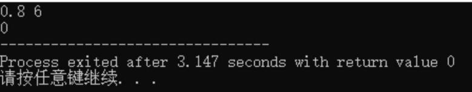

# 第 3 课：实数类型

蛙蛙自从学了编程后，看到什么都能想到编程。

这天他来到了文具店，想买几支铅笔，想用编程来计算铅笔的总价。老板告诉他一支铅笔的价格是 0.8 元，假设蛙蛙一共买了 6 支铅笔，于是他在编程环境中写下了：

```cpp
#include <iostream>
using namespace std;
int main()
{
    int price,cnt; // price 用来表示价格，cnt 用来表示数量
    cin >> price >> cnt;
    cout << price * cnt;
    return 0;
}
```

蛙蛙信心满满地点击"编译运行"，并且输入了 0.8 和 6，期望得到正确的结果，但是控制台上显示了 0（见图 1-8）。难道买 6 支铅笔不用付钱？

图 1-8　运行结果



蛙蛙看到控制台上的结果陷入了疑惑，于是又来请教了氪町博士。

氪町博士有些不开心，因为他之前就已经告诉蛙蛙，int 只能用来申请盛放整数的盒子，小数是不能放进来的，所以得不到正确的值。那么，为什么会出现 0 这个结果呢？

氪町博士继续解释道，在 C++ 中，int 表示的是整数类型，如果试图将小数（比如 0.8）赋值给 int 类型的变量，会发生隐式类型转换，此时编译器会截断小数部分，所以刚才的价格保存的就是 0.8 的整数部分，也就是 0 了，再用 0 乘 6 得到的结果依然是 0。

如果想要申请一个盛放小数的盒子，可以使用 double 来申请，比如将 price 声明为 double 类型：

```cpp
double price;
```

像这种主要用于存储带有小数部分数值的类型，我们称为实数类型或浮点型。

## 3.1 实数类型的相关操作

这里我们以定义一个带有小数点的变量 price 为例，给它赋值为 0.8。

- 定义格式：`double price;`
- 赋值：`price = 0.8;`
- 输入：`cin >> price;`
- 输出：`cout << price;`

我们称 double 为双精度浮点型。有时你可能看到有人使用 float 来存储小数，float 为单精度浮点型，用法与 double 一致。

顾名思义，双精度浮点型（double）的取值范围更广，约为 −1.7 × 10³⁰⁸ ~ 1.7 × 10³⁰⁸，而单精度浮点型能够表示的范围约为 −3.4 × 10³⁸ ~ 3.4 × 10³⁸。因此，前期我们仅使用 double 类型即可。

## 3.2 实例讲解一

### 例 1：铅笔的价格

蛙蛙自从学了编程之后，对其他学科的兴趣也上来了，消耗铅笔的速度也快了起来，所以他的铅笔很快就用完了，于是他来到了文具店，准备买一些铅笔。

已知一支铅笔的价格是 0.8 元，如果蛙蛙想用刚学的实数类型变量来保存铅笔的价格，他应该如何编写呢？

【输出格式】输出一行，为一支铅笔的价格。

【输出样例】0.8

**解析**

这个题目仅考查实数类型变量的声明及输出，只需要用 double 来声明一个变量，并进行赋值，再输出即可。

**参考代码**

```cpp
#include <iostream>
using namespace std;
int main()
{
    double price = 0.8;
    cout << price;
    return 0;
}
```

### 例 2：小氪奶糖

为庆祝班级在校庆活动中的节目取得第一名，老师委托蛙蛙买一些小氪奶糖分给班里的所有同学。

已知一斤糖果 19.8 元，蛙蛙先买了 5 斤，但是分到一半就分完了，所以蛙蛙又去买了 4 斤糖果。请问蛙蛙买糖果一共花了多少钱？

由于蛙蛙已经习惯使用编程计算了，所以这次蛙蛙还是希望能够用刚学的实数类型变量来进行输出。

【输出格式】通过实数类型变量的形式，输出一行，为买糖果一共的花费。

【输出样例】178.2

**解析**

由于糖果的价格是浮点型的，所以我们可以声明一个 double 类型的变量 a 来表示糖果的单价。

蛙蛙前后买的糖果斤数都是整型的，可以声明为 int 类型。

然后输出糖果的单价 * 前后买的糖果总量即为所求。

**参考代码**

```cpp
#include <iostream>
using namespace std;
int main()
{
    double a = 19.8; // 糖果的单价
    int b = 5,c = 4; // 前后各买了 5 斤和 4 斤
    cout << a * (b + c); // 糖果的总价
    return 0;
}
```

## 3.3 格式化输出

编译运行后，蛙蛙发现结果只有一位小数，但是结账时账单上显示为 178.20。

他又观察了之前购买商品的小票，发现所有小票上的价格都是保留小数点后两位。蛙蛙也想保留两位小数，该怎么做呢？

氪町博士告诉蛙蛙，我们可以使用格式化输出来保留小数点后任意位。

格式化输出所用的函数为 printf，它可以输出任意位数的小数。

使用格式：`printf("%.nf",a);`。

上面这句话的作用是将变量 a 保留 n 位小数输出。

但是还有一些细节要注意。

1) 这里的 n，需要具体化为一个数，保留几位小数就把 n 改为几，比如保留两位小数，n 就改成 2，保留三位小数，n 就改成 3。

2) `%` 后面的小数点一定不能漏掉。

3) 使用 printf 函数的时候，一定要注意加上头文件 `#include <cstdio>`。

比如将小数 3.1415926 保留两位小数输出，程序如下：

```cpp
#include <iostream>
#include <cstdio>
using namespace std;
int main()
{
    printf("%.2f",3.1415926);
    return 0;
}
```

编译运行后，输出结果为 3.14。

如何使用 printf 输出多个变量呢？这里以输出两个变量 a 和 b 为例：

```cpp
printf("%.2f%.3f",a,b);
```

上面这行代码编译运行的结果是将 a 保留两位小数输出，将 b 保留三位小数输出。

也就是说，要输出多少个变量，双引号里就要有多少个 `%.nf`，并且每个 `%.nf` 与后面的变量都是一一对应的，变量名之间用逗号隔开即可。

但仅仅这样处理还不够，因为这两个结果紧紧地挨在一起，还需要将多个变量进行分隔。

在 cout 中，直接使用连接符连接一个空格或 endl 即可将多个变量使用空格或换行隔开，格式化输出是如何处理的呢？

1) 使用空格分隔时，只要在两个 `%.nf` 之间加一个空格即可，形式为：

```cpp
printf("%.2f %.2f",a,b);
```

这个程序输出了两个保留两位小数的值，并且这两个值用空格隔开。

2) 使用换行分开，是在两个 `%.nf` 之间加上 `\n`，形式为：

```cpp
printf("%.2f\n%.2f",a,b);
```

我们已经学习了如何保留 n 位小数，以及多个变量之间的分隔，接下来我们利用所学知识完成下面的例题。

## 3.4 实例讲解二

### 例 3：蛙蛙买香蕉

蛙蛙最近特别喜欢吃香蕉，于是蛙蛙妈妈准备买些香蕉放在家里给蛙蛙吃。

蛙蛙妈妈准备来到水果店买 5.5 斤香蕉，水果店一斤香蕉的价格是 n 元，请问蛙蛙妈妈一共要付多少钱？（结果保留两位小数。）

【输入格式】输入一行，这一行仅有一个实数，表示香蕉的单价。

【输出格式】输出一行，为最终共需要付的金额，并且需要保留两位小数。

【输入样例】5.20

【输出样例】28.60

**解析**

通过输入格式，我们得知输入的香蕉的单价也是实数类型的，可以用 double 来声明变量。

输出结果需要保留两位小数，可以使用刚刚学习过的格式化输出 printf，同时需要添加头文件 cstdio。

**参考代码**

```cpp
#include <iostream>
#include <cstdio>
using namespace std;
int main()
{
    double a = 5.5,b;
    cin >> b; // 输入香蕉的单价
    printf("%.2f",a*b); // 计算香蕉的总价并保留两位小数
    return 0;
}
```

### 例 4：两种水果的价格

蛙蛙很快吃完了妈妈买的香蕉，于是妈妈准备继续去水果店买一些香蕉。

来到水果店后，妈妈发现这里的苹果非常新鲜，于是也买了些苹果。

已知蛙蛙妈妈买的香蕉和苹果的重量都是 4.5 斤，香蕉的单价为 m，苹果的单价为 n，请你分别求出两种水果花了多少钱（保留两位小数，两个值用空格隔开）。

【输入格式】输入一行，两个实数 m 和 n，分别表示香蕉和苹果的单价。

【输出格式】输出一行，为香蕉的总价和苹果的总价，结果保留小数点后两位。

【输入样例】5.20 4.50

【输出样例】23.40 20.25

**解析**

保留两位小数输出可以使用格式化输出 printf，若输出两个变量并且都保留两位小数，则在 printf 的括号里面添加两个 `%.2f` 并写在双引号里面，后面紧跟着两个变量，比如 a 和 b。

若要使用空格隔开，直接在两个 `%.2f` 中间打一个空格即可，格式如下：

```cpp
printf("%.2f %.2f",a,b);
```

其中 a 对应的是前面一个 `%.2f`，b 对应后面一个。

**参考代码**

```cpp
#include <iostream>
#include <cstdio>
using namespace std;
int main()
{
    double m,n,a = 4.5; // a 表示每种水果的重量
    cin >> m >> n; // 分别输入香蕉和苹果的单价
    printf("%.2f %.2f",m*a,n*a); // 输出结果并分别保留两位小数
    return 0;
}
```

### 例 5：三种水果的价格

蛙蛙妈妈又来到水果店来买水果，这次买了香蕉、苹果和火龙果，这三种水果都买了 6.5 斤，三种水果的单价分别是 a、b 和 c，请你分别求出这三种水果的价格（保留两位小数，分三行输出）。

【输入格式】输入一行，三个实数 a、b 和 c，分别代表香蕉、苹果和火龙果的单价。

【输出格式】输出三行，分别是香蕉、苹果和火龙果单种水果的总价。

【输入样例】5.20 4.50 6.50

【输出样例】

```
33.80
29.25
42.25
```

**解析**

使用格式化输出的浮点型数值，若要使用换行隔开，可以在两个 `%.nf` 之间添加 `\n`，比如对 a、b、c 三个变量均保留两位小数并且换行隔开的格式如下：

```cpp
printf("%.2f\n%.2f\n%.2f",a,b,c);
```

**参考代码**

```cpp
#include <iostream>
#include <cstdio>
using namespace std;
int main()
{
    double a,b,c,d = 6.5; // d 表示每种水果的重量
    cin >> a >> b >> c; // 输入三种水果的单价
    printf("%.2f\n%.2f\n%.2f",a * d,b * d,c * d); // 分三行输出三种水果的总价
    return 0;
}
```
