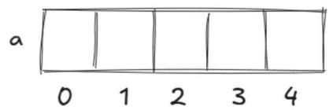

# 第 19 课：一维数组

数组和字符串在生活中的应用十分广泛。

就拿体育赛事来说，运动员的成绩排名会存储在数组里，方便记录和查询；课程表的安排也能用数组清晰呈现，一周内每天的课程被当作数组元素，让师生能快速了解课程安排；家庭的开支记录同样会用到数组，比如可以将水电费、食品费等各项开支作为数组元素，方便统计和分析家庭消费情况。

字符串可用于身份识别和商品管理等。每个人的身份证号码都是独一无二的字符串，蕴含地区、出生日期等关键信息，用于确认身份；电话号码也可以看作字符串，可帮助人们建立通信连接，实现通话和短信功能；商品条形码同样也是一种特殊的字符串，收银员扫码即可获取商品信息，方便购物结算、管理库存和统计销售数据。

数学老师自从知道蛙蛙学习编程后，不知不觉已经找他帮忙解决很多数学相关的问题了。

这次他又想让蛙蛙帮他统计班级里 50 名学生的数学考试成绩，计算数学成绩的总分、平均分，并且找出最高分和最低分等。

这可难倒了蛙蛙。虽然他现在能打印出班级里 50 名学生的数学成绩，并且能计算总分和平均分，但总不能用 50 个变量来保存这 50 名学生的成绩吧！也太难管理了！

这不，蛙蛙为了不让数学老师失望，立马去找氪町博士帮忙。氪町博士急忙给蛙蛙补课，教他数组相关的知识，告诉他通过一个一维数组就可以保存这 50 名同学的信息了。

让我们跟蛙蛙一起学习一维数组的知识吧！

## 19.1 数组的概念及定义

### 数组的概念

数组就是将相同数据类型的元素按一定顺序排列而成的集合，它将这些数据存储在连续的内存空间中，每个数据元素都可以通过一个索引（下标）来访问。

我们可以将数组理解为一列火车，车厢是从 1 开始编号的，车头可以算成 0 号车厢。同样，数组也是从 0 开始编号的，车厢就是数组空间，可以存放数据元素。

### 数组的定义

```cpp
int a[5]; // 定义一个能够存放整型的数组 a，同时申请 5 个空间
```

其中，a 是一维数组的数组名，该数组有 5 个元素，依次表示为：

```cpp
a[0]、a[1]、a[2]、a[3]、a[4]
```

可以想象有图 4-1 所示的五个空间。

图 4-1　一维数组



a 是变量名，0、1、2、3、4 均为下标，需要注意的是，a[5] 不属于该数组的空间范围，严禁下标越界。

但是由于习惯问题，前期我们从 1 号元素开始使用（熟练后可从 0 号元素开始使用），所以一般我们定义的数组大小会比实际数据范围稍微大一些，比如我们可以像下面这样写。

```cpp
#include <iostream>
using namespace std;
int main()
{
    int a[10]; // 定义一个长度为 10 的整型数组 a
    for (int i = 1; i <= 5; i++) // 循环 5 次，i 的值从 1 到 5
    {
        cin >> a[i]; // 输入 a[1] 到 a[5] 共 5 个元素
    }
    for (int i = 1; i <= 5; i++) // 循环 5 次，i 的值从 1 到 5
    {
        cout << a[i] << " "; // 输出刚刚输入的 5 个元素，用空格隔开
    }
    return 0;
}
```

## 19.2 实例讲解

### 例 1：清点货物

在热闹的火车站里，一列长长的火车停靠在站台。每节火车车厢就像一个大大的魔法口袋，能装好多好多的货物。为了方便大家快速找到想要的货物，工作人员都是按照车厢一节一节地装载货物的。

这时候，车站站长走到蛙蛙面前，耐心地告诉蛙蛙每一节车厢里都存放了多少货物。蛙蛙认真地听着，可数字实在太多，把蛙蛙的小脑袋都快弄晕了。

当火车到达下一站时，蛙蛙要把这些车厢里货物的具体数量一五一十地告诉老师。但是这么多数字可怎么记得住呀！聪明的你，能不能编写一个程序来帮帮蛙蛙，把这些数都稳稳当当地记录下来呢？（这列火车最多可有 100 节车厢。）

【输入格式】输入两行。第 1 行输入一个正整数 n，表示车厢数量（n ≤ 100）。

第 2 行输入 n 个整数，表示每个车厢里面货物的数量，每节车厢的货物数量不超过 10000。

【输出格式】输出一行，共 n 个数，用空格隔开，表示货物的数量。

【输入样例】

```
5
3 2 5 4 1
```

【输出样例】3 2 5 4 1

**解析**

1) 定义一个整型数组 a，数组大小不能小于 100。若从下标 1 的位置开始用，就要定义得大一些，比如 110。之所以定义为 110，是为了确保数组有足够的空间来存储最多 100 节车厢的货物，同时预留一些额外空间以避免边界问题。

2) 通过 for 循环进行计数，i 从 1 开始，每次循环 i 的值增加 1，直到 i 大于输入的 n（n 为车厢数量）时循环结束。

3) 在每次循环中，都需要从标准输入读取一个整数，并将其存储到数组 a 的第 i 个元素中，这样就能够完成每节车厢货物数量的输入。

4) 再使用一个 for 循环，遍历数组 a 的前 n 个元素，然后通过 cout 语句输出数组 a 的第 i 个元素，每输出一个数便需要在后面加上一个空格。

**参考代码**

```cpp
#include <iostream>
using namespace std;
int main()
{
    int n, a[110];
    cin >> n;
    for (int i = 1; i <= n; i++)
        cin >> a[i];
    for (int i = 1; i <= n; i++)
        cout << a[i] << " ";
    return 0;
}
```

### 例 2：临时抽查

在一座繁忙的货运中间站，一列装载着大量货物的火车缓缓停靠。这列火车共有 n 节车厢，每节车厢都像是一个神秘的"宝藏盒"，里面满满当当地装着各式各样的货物。由于铁路部门的临时安全检查安排，车站工作人员需要对其中特定的一节车厢进行详细抽查。

此时，经验丰富的老站长把蛙蛙叫到跟前，耐心地告诉蛙蛙每一节车厢里存放货物的具体数量。蛙蛙认真地记录着这些信息，可车厢数量不少，对应的货物数量数据也挺多，把蛙蛙的脑袋都快弄晕了。

现在火车已经稳稳地停在站台上，检查即将开始。按照检查要求，需要对第 k 节车厢进行抽查，蛙蛙必须准确地说出这节车厢里装了多少货物。但是这么多车厢的货物数量数据，他担心自己会记错。聪明的你，能不能编写一个程序来帮帮蛙蛙，让他能快速准确地找到第 k 节车厢对应的货物数量呢？

已知这列火车最多可有 100 节车厢，且 2 ≤ k ≤ n ≤ 100。

【输入格式】输入两行。

第 1 行输入两个正整数 n 和 k，用空格隔开，n 表示车厢数量，k 表示需要抽查的车厢序号。

第 2 行输入 n 个整数，用空格隔开，表示每节车厢里面货物的数量，每节车厢的货物数量不超过 10000。

【输出格式】输出一行，一个整数，表示第 k 节车厢里货物的数量。

【输入样例】

```
5 3
11 15 8 7 10
```

【输出样例】8

**解析**

在上一题输入一组数据的基础上进行输出，无须进行遍历输出每一个数据，只需要输出 a[k]，即：`cout << a[k];`。

**参考代码**

```cpp
#include <iostream>
using namespace std;
int main()
{
    int n, k, a[110];
    cin >> n >> k;
    for (int i = 1; i <= n; i++)
        cin >> a[i];
    cout << a[k];
    return 0;
}
```

### 例 3：逆序清点

为了方便货物的管理和查找，工作人员严格按照火车车厢的顺序进行货物装载，每节车厢都有其特定的货物存储任务。

当火车稳稳地停靠在站台上后，经验丰富的老站长接到了一项重要任务：从火车的最后一节车厢开始，依次向前清点每节车厢内货物的数量。老站长手持记录板，准备开始这项细致的工作。然而，这列火车的车厢数量不少，要准确无误地从后往前记录每节车厢的货物数量，并非易事。

聪明的你，能不能编写一个程序来模拟老站长的清点过程，帮助他快速准确地记录下从后往前清点时每节车厢货物的数量呢？已知这列火车最多可有 100 节车厢。

【输入格式】输入两行。第 1 行输入一个正整数 n，表示车厢数量（n ≤ 100）。

第 2 行输入 n 个整数，表示每个车厢里面货物的数量，每节车厢的货物数量不超过 10000。

【输出格式】输出一行，包含 n 个整数，用空格分隔，表示从最后一节车厢往前清点时每节车厢货物的数量。

【输入样例】

```
7
12 11 9 15 13 14 10
```

【输出样例】10 14 13 15 9 11 12

**解析**

1) 在例 1 输入一组数据的基础上进行输出，同样需要使用 for 循环进行遍历，i 初始化为 n（即最后一节车厢的索引），每次循环 i 的值减 1，直到 i 小于 1 时循环结束。通过这种方式，我们实现了从最后一节车厢往前遍历数组。

2) 然后使用 cout 语句在循环内输出每一个元素，每输出一个元素都需要用空格隔开。

**参考代码**

```cpp
#include <iostream>
using namespace std;
int main()
{
    int n, a[110];
    cin >> n;
    for (int i = 1; i <= n; i++)
        cin >> a[i];
    for (int i = n; i >= 1; i--)
        cout << a[i] << " ";
    return 0;
}
```
