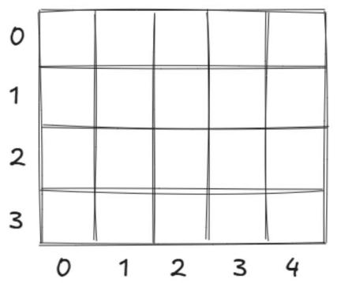

# 第 20 课：二维数组

在上一节中我们提到，一维数组就像是一列火车，我们可以把车头看作 0 号车厢，紧接着后面是 1 号、2 号、3 号等车厢。

假设我们现在就在火车站，看见了有很多辆长度一样的火车。为了区别这些火车，我们尝试把它们分别命名为 a1、a2、a3……那么 a1[2] 就可以用来表示第一列火车的 2 号车厢。

如果把一列火车当作一个元素，那么这些火车就会组成一个一维数组，而这个一维数组里面的每一个元素都是一个小的一维数组，这样组成了一个二维数组。

即一个二维数组需要使用两个数来控制位置。

## 20.1 二维数组的定义与操作

二维数组可以看作数组的数组，即它是由多个一维数组组成的。在 C++ 中，二维数组可以通过定义两个维度的大小来创建，其中第一个维度通常表示行，第二个维度表示列。

### 二维数组的定义

```cpp
数据类型 数组名 [常量表达式 1][常量表达式 2]
```

例如：

```cpp
int a[4][5];
```

上面代码定义了一个 4 行 5 列的二维整型数组，数组名为 a，相当于申请了一片空间，每个格子都可以存放一个元素（见图 4-2）。

图 4-2　二维数组



### 引用数组元素

如果需要使用二维数组中的某个元素，就需要找到具体位置：

```cpp
数组名 [行下标][列下标]
```

如 a[1][2] 表示二维数组 a 中的第 2 行第 3 列的元素，同样需要注意的是行下标和列下标都是从 0 开始编号的。

也因此，每个下标表达式的取值范围不应超出下标所指定的范围。

例如数组定义为 `int a[2][3];`，则表示 a 是 2 行 3 列的二维数组，共有 2 × 3 = 6 个元素，如表 4-1 所示。

表 4-1　2 行 3 列的二维数组 a

| a[0][0] | a[0][1] | a[0][2] |
|---------|---------|---------|
| a[1][0] | a[1][1] | a[1][2] |

因此可以把它看成一个矩阵（表格），a[1][2] 即表示第 2 行第 3 列的元素，而 a[2][3] 就已经越界了。

### 二维数组的输入

```cpp
#include <iostream>
using namespace std;
int main()
{
    int a[10][10]; // 定义一个 10 行 10 列的二维数组 a
    for (int i = 1; i <= 3; i++) // 控制行下标
    {
        for (int j = 1; j <= 4; j++) // 控制列下标
            cin >> a[i][j];
    }
    return 0;
}
```

### 二维数组的输出

```cpp
for (int i = 1; i <= 3; i++)
{
    for (int j = 1; j <= 4; j++)
        cout << a[i][j] << " "; // 每个元素用空格隔开
    cout << endl; // 每一行输出结束之后需要手动换行
}
```

## 20.2 实例讲解一

### 例 1：神秘迷宫地图

你正在玩一款冒险游戏，游戏的某个关卡中有一张神秘的迷宫地图。

这个迷宫地图被设计成一个矩阵的形状，由 m 行 n 列的小方格组成，其中 m 和 n 的取值范围在 2 和 20 之间。每个小方格里面都有一个数，代表着给你的奖励，数的大小在 10000 以内。

为了更好地规划你的冒险路线，你需要编写一个程序，将这个迷宫地图内的所有数原样输出，从而了解整个迷宫的布局信息。

【输入格式】输入 m + 1 行。

第 1 行输入 m 和 n，分别表示二维数组的行数和列数。

接下来 m 行，每行 n 个数，表示二维数组中的每个元素。

【输出格式】输出 m 行，每行 n 个数，将输入的二维数组原样输出。

【输入样例】

```
2 3
1 3 4
2 6 8
```

【输出样例】

```
1 3 4
2 6 8
```

**解析**

本题要求读取一个 m 行 n 列的二维数组，然后将其原样输出。

可以通过两个嵌套的循环完成输入和输出的操作，其中第一个嵌套循环用于读取二维数组内的所有元素，第二个嵌套循环用于输出二维数组内的所有元素。

**参考代码**

```cpp
#include <iostream>
using namespace std;
int a[22][22], m, n;
int main()
{
    cin >> m >> n;
    for (int i = 1; i <= m; i++)
    {
        for (int j = 1; j <= n; j++)
            cin >> a[i][j];
    }
    for (int i = 1; i <= m; i++)
    {
        for (int j = 1; j <= n; j++)
            cout << a[i][j] << " ";
        cout << endl;
    }
    return 0;
}
```

### 注意事项

二维数组尽量在主函数之外定义，因为在主函数内定义数组时分配的空间是有限的，并且相对较小。当定义一个规模较大的二维数组时，程序可能会迅速耗尽空间，导致溢出。

而定义在主函数外面的数组（全局数组）通常比定义在主函数内的数组分得的空间大得多，这意味着可以定义更大规模的二维数组，而不用过于担心溢出的问题，并且全局数组（或者变量）在定义时会被自动初始化为 0。

### 例 2：找货物

由于铁路运输的安全检查要求，工作人员需要对特定车厢进行抽查。

此时经验丰富的老站长接到任务单，指示要对第 x 列火车的第 y 节车厢展开检查。老站长深知任务的重要性，他必须准确无误地掌握这节车厢内货物的具体情况。

然而，面对众多的火车和车厢，要迅速找到并确定这节车厢的货物数量并非易事。

经过之前的练习，蛙蛙已经掌握了数组的使用方法，准备通过数组帮助站长完成这项任务，已知这个货运场中最多有 20 列火车，且每列火车最多有 20 节车厢。

【输入格式】输入 m + 1 行。

第 1 行输入 m、n、x、y，分别表示火车的列数 m、车厢数 n，以及要找的元素所在的火车列数 x 和车厢数 y（m、n、x、y 都是不大于 20 的正整数）。

接下来共输入 m 行，每行有 n 个数，均不超过 10000，表示火车上每节车厢中的货物数量。

【输出格式】输出一行，一个数，表示第 x 列火车第 y 节车厢内的货物数量。

【输入样例】

```
3 4 2 2
1 2 3 4
4 5 6 7
7 8 9 10
```

【输出样例】5

> 注：原书输出样例跨页丢失，此处按输入样例（第 2 行第 2 列元素为 5）补全。

**解析**

本题要求在输入二维数组之后，直接输出数组中第 x 行第 y 列的元素，即 `cout << a[x][y];`。

**参考代码**

```cpp
#include <iostream>
using namespace std;
int m, n, x, y, a[30][30];
int main()
{
    cin >> m >> n >> x >> y;
    for (int i = 1; i <= m; i++)
        for (int j = 1; j <= n; j++)
            cin >> a[i][j];
    cout << a[x][y]; // 直接输出二维数组 a 中第 x 行第 y 列的元素
    return 0;
}
```

### 例 3：停错的火车

在清点货物的时候，蛙蛙发现第 x 列火车和第 y 列火车停反位置了，那么正确的情况下清点的每节车厢货物的数量应该是什么样子的呢？（最多有 20 列火车，每列火车最多有 20 节车厢。）

【输入格式】输入 m + 1 行。

第 1 行输入 m、n、x、y，分别表示火车的列数 m、车厢数 n 以及停错的两列火车 x 和 y（m、n、x、y 都是不大于 20 的正整数）。

接下来共输入 m 行，每行有 n 个数，均不超过 10000，表示火车上每节车厢中的货物数量。

【输出格式】输出 m 行，每行 n 个数，表明正确的货物排列的样子，行内元素用空格隔开，每行元素换行隔开。

【输入样例】

```
5 2 4 5
1 7
4 3
4 7
10 7
10 4
```

【输出样例】

```
1 7
4 3
4 7
10 4
10 7
```

> 注：原书此题的输入样例混入了扫描残留乱码"42582852369396"，输出样例被拆成多行且顺序错乱。此处按题意（交换第 4 行与第 5 行）与残留数据复原为 5 行 2 列的自洽样例。

**解析**

1) 如何交换两列火车的车厢货物数量？先遍历火车的每一节车厢，再借助临时变量 temp 来交换第 a 列火车和第 b 列火车相同位置车厢的货物数量。代码如下：

```cpp
for (int j = 1; j <= n; j++) // 从第 1 节车厢遍历到第 n 节车厢
{
    temp = s[a][j]; // 将第 a 列火车的元素赋值给 temp
    s[a][j] = s[b][j]; // 再将第 b 列火车的元素赋值给第 a 列火车
    s[b][j] = temp; // 再将原来第 a 列火车的元素赋值给第 b 列火车，完成交换
}
```

以样例中 4 5 6 7 和 7 8 9 10 这两行为例，交换这两行的数值，首先将数字 4 与数字 7 进行交换，一直交换到这两行的最后一列。

2) 最后通过双重 for 循环，直接输出二维数组的值，按行每输出一个元素需要输出一个空格，每输出一行元素需要输出一个换行。

**参考代码**

```cpp
#include <iostream>
using namespace std;
int s[101][101], m, n, a, b, temp;
int main()
{
    cin >> m >> n >> a >> b;
    for (int i = 1; i <= m; i++) // 输入二维数组的每个元素
    {
        for (int j = 1; j <= n; j++)
            cin >> s[i][j];
    }
    for (int j = 1; j <= n; j++) // 交换两行数值
    {
        temp = s[a][j];
        s[a][j] = s[b][j];
        s[b][j] = temp;
    }
    for (int i = 1; i <= m; i++) // 输出交换后的每个元素
    {
        for (int j = 1; j <= n; j++)
            cout << s[i][j] << " ";
        cout << endl;
    }
    return 0;
}
```

## 20.3 矩阵对角线

在一个 m 行 m 列的矩阵（又称为方阵）中，从左上角到右下角这一斜线上的 m 个元素，叫作主对角线上的元素，这条斜线称为主对角线。从右上角到左下角这一斜线上的 m 个元素，叫作副对角线上的元素，这条斜线称为副对角线。


### 主对角线

根据上面的矩阵，主对角线上的元素分别是 a11、a22、a33、a44，我们可以发现，主对角线上的元素都有一个共同点，就是行下标和列下标是相等的，这里用 i 表示行、j 表示列，可以这样描述：在一个 m 行 m 列的矩阵中，若 i 和 j 相等的话，说明第 i 行第 j 列的元素在主对角线上。

代码描述如下：

```cpp
for (i = 1; i <= m; i++)
{
    for (j = 1; j <= m; j++)
    {
        if (i == j) // 在一个方阵中，若行下标和列下标相等则说明这个元素在主对角线上
        {
            cout << a[i][j] << endl; // 输出主对角线上的数
        }
    }
}
```

### 副对角线

副对角线上的元素分别为 a14、a23、a32、a41，副对角线上的元素也有共同点，就是行下标和列下标之和与行/列的总数加 1 的值相等，这里同样用 i 表示行、j 表示列，可以这样描述：在一个 m 行 m 列的矩阵中，若 i + j 的值与 m + 1 的值相等（即 i + j == m + 1）的话，说明这个元素在副对角线上。代码描述如下：

```cpp
for (i = 1; i <= m; i++)
{
    for (j = 1; j <= m; j++)
    {
        if (i + j == m + 1) // 行下标和列下标之和与行/列的总数加 1 的值相等
        {
            cout << a[i][j] << endl; // 输出副对角线上的数
        }
    }
}
```

## 20.4 实例讲解二

### 例 4：主对角线元素求和

现在有一个 n × n 的方阵，你要找到该方阵的主对角线上所有的元素，并且求这些元素的总和。（1 ≤ n ≤ 30，元素的值不超过 10000。）

【输入格式】输入 n + 1 行。

第 1 行输入一个正整数 n，表示二维数组的行数和列数（均为 n）。

接下来输入 n 行，每行 n 个数，表示二维数组中每个元素。

【输出格式】输出两行。

第 1 行为主对角线上所有元素，元素之间用空格隔开。

第 2 行为主对角线上元素的总和。

【输入样例】

```
3
2 4 6
5 3 9
8 7 1
```

【输出样例】

```
2 3 1
6
```

**解析**

本题要求处理一个 n × n 的方阵，找出方阵主对角线上的所有元素，并计算这些元素的总和。主对角线是指从方阵左上角到右下角的那条斜线，该斜线上元素的特点是其行下标和列下标相等。

1) 先输入方阵的行数和列数 n，接着输入方阵中每个元素的值。

2) 若行下标和列下标相等，说明该元素是主对角线上的元素，则需要进行输出，元素间用空格分隔，并且需要将这些元素的值相加保存，然后换行输出这些元素的总和。

**参考代码**

```cpp
#include <iostream>
using namespace std;
int n, a[32][32], c;
int main()
{
    cin >> n;
    for (int i = 1; i <= n; i++)
        for (int j = 1; j <= n; j++)
            cin >> a[i][j];
    for (int i = 1; i <= n; i++)
        for (int j = 1; j <= n; j++)
            if (i == j)
            {
                cout << a[i][j] << " ";
                c += a[i][j];
            }
    cout << endl << c;
    return 0;
}
```

### 例 5：两条对角线上的和

现在有一个 n × n 的方阵，请你求出该方阵对角线上的所有元素的总和。（对角线包括主对角线和副对角线，1 ≤ n ≤ 30，元素的值不超过 10000。）

【输入格式】输入 n + 1 行。

第 1 行输入一个正整数 n，表示二维数组的行数和列数（均为 n）。

接下来输入 n 行，每行 n 个数，表示二维数组中每个元素。

【输出格式】输出一行，一个数，表示对角线上元素的总和。

【输入样例】

```
3
2 4 6
5 3 9
8 7 1
```

【输出样例】20

**解析**

主对角线和副对角线上的数均需要求和，即满足行下标等于列下标的，或者行下标和列下标之和与总的行数加 1 相等的，均需要求和。

注意：当 n 为奇数时，两条对角线会在中心元素处相交，该元素只能计算一次，否则会被重复累加（原书参考代码未处理这一点，会使样例 3 × 3 方阵的结果变成 23 而非 20，此处已修正）。

**参考代码**

```cpp
#include <iostream>
using namespace std;
int n, a[30][30], c;
int main()
{
    cin >> n;
    for (int i = 1; i <= n; i++)
        for (int j = 1; j <= n; j++)
            cin >> a[i][j];
    for (int i = 1; i <= n; i++)
        for (int j = 1; j <= n; j++)
        {
            if (i == j) c += a[i][j]; // 主对角线
            if (i + j == n + 1 && i != j) c += a[i][j]; // 副对角线，排除中心重复元素
        }
    cout << c;
    return 0;
}
```
