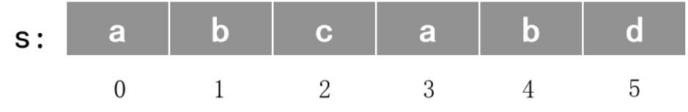
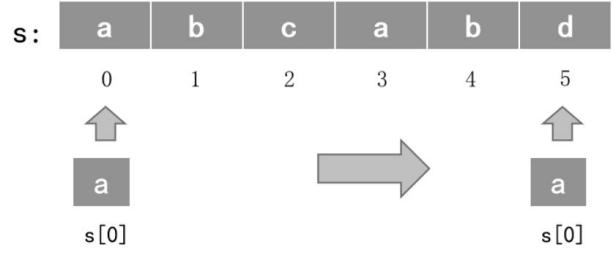
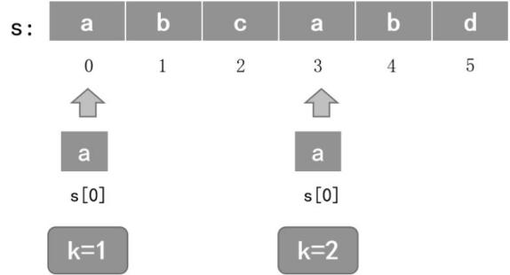

# 第 21 课：字符串与字符数组

在讲解字符串和字符数组之前，我们先回顾一下字符类型。大家还记得什么是字符类型吗？

字符类型（char）是一种数据类型，和实数类型、整型类似，不同的是一个字符类型变量可存储的内容为单个字符（蛙蛙发现自己记不起来了，于是他赶紧复习了 1.6 节的内容）。

字符变量定义为：

```cpp
char 字符变量;
```

字符类型是一个有序的类型，字符的大小顺序按其 ASCII 码的大小而定。

现在我们通过一个简单的案例考查一下你是否还记得字符类型的知识：请你按字母表顺序和逆序每隔一个字母打印字母表。

即要求你从 a 开始隔一个字母打印下一个字母，比如打印 a 之后打印 c，然后是 e，一直打印到最后一个字母 z（如果能打印到的话），再换行逆序从 z 开始直到打印字母 a（如果能打印到的话）结束，每两个字母之间需要打印一个空格。

输出的结果如下，但要求不能直接输出这些字符：

```
a c e g i k m o q s u w y
z x v t r p n l j h f d b
```

蛙蛙回顾完字符类型的知识点之后，觉得这很简单，只要从字符 a 遍历到字符 z，每次变化的量加 2 即可，也就是 `for (char i = 'a'; i <= 'z'; i += 2)`，接着输出 i，但要注意 i 是 char 类型的。倒序输出也类似，从字符 z 遍历到字符 a，每次减 2 即可，也就是 `for (char i = 'z'; i >= 'a'; i -= 2)`，然后输出 i，参考代码如下：

```cpp
#include <iostream>
using namespace std;
int main()
{
    for (char i = 'a'; i <= 'z'; i += 2)
        cout << i << " ";
    cout << endl;
    for (char i = 'z'; i >= 'a'; i -= 2)
        cout << i << " ";
    return 0;
}
```

编译运行后，果然无误，给蛙蛙和自己点个赞吧！

> 注：原书倒序输出样例写作“z x r v t p n l j h f d b”，与 `i -= 2` 的实际运行结果不符，此处已按程序输出修正为“z x v t r p n l j h f d b”。

## 21.1 字符串

字符串主要有以下两种定义方式，一种不赋初始值，另一种赋初始值：

```cpp
string s1; // 定义一个字符串 s1
string s2 = "Hello world!"; // 定义字符串 s2 并初始化字符串为 "Hello world!"
```

注意　在 C++ 中，声明 string 通常需要包含 string 头文件，即 `#include <string>`。

### 字符串与字符的区别

字符与字符串的区别见表 4-2。

表 4-2　字符与字符串的区别

| | 字符 | 字符串 |
|---|------|--------|
| 区分标志 | 一对单引号 | 一对双引号 |
| 包含内容 | 1 个字符 | 0 个到多个字符 |
| 所占字节数 | 1 字节 | 字符个数 + 1 字节 |

注意　字符串的末尾隐藏了一个 `'\0'`，它的 ASCII 码的值为 0。

> 注：原书将此处的 ASCII 误写为 ACSII，此处已修正。

### 例 1：输出两个单词

蛙蛙在控制台输入了两个用空格隔开的单词，他现在希望这两个单词能换行输出。

【输入格式】输入一行，两个英文单词，用空格隔开。

【输出格式】输出两行，将输入的两个单词换行输出。

【输入样例】

```
coding wa
```

【输出样例】

```
coding
wa
```

**参考代码**

```cpp
#include <iostream>
#include <string>
using namespace std;
int main()
{
    string s1, s2; // 声明两个字符串变量
    cin >> s1 >> s2; // 输入这两个字符串
    cout << s1 << endl << s2; // 换行输出这两个字符串
    return 0;
}
```

## 21.2 字符数组

字符数组本质上是由一系列字符元素组成的数组，这些字符依次存储在内存中，其中每个字符占据一个存储单元，在 ASCII 编码下一个字符通常占 1 字节。

### 字符数组的定义

字符数组的定义格式与一般的数组相似，所不同的是数组类型是字符型，第一个元素同样是从下标 0 开始，而不是从下标 1 开始。具体的格式如下：

```cpp
char 数组名[常量表达式 1][常量表达式 2]…
```

例如：

```cpp
char ch1[5]; // 数组 ch1 是一个具有 5 个字符元素的一维字符数组
char ch2[3][5]; // 数组 ch2 是一个具有 15 个字符元素的二维字符数组
```

### 字符数组的赋值

字符数组的赋值与一般的数组赋值相似，赋值分为数组的初始化和对数组元素进行赋值。

初始化的方式有用字符初始化和用字符串初始化两种，也有用数组元素赋值进行初始化的。

1) 用字符初始化数组

例如：

```cpp
char chr1[5] = {'a', 'b', 'c', 'd', 'e'};
```

说明：初始值表中的每个数据项是一个字符，用字符给数组 chr1 的各个元素初始化。

2) 用字符串初始化数组

例如：

```cpp
char chr2[5] = "abcd";
```

说明：字符串的长度应小于字符数组的大小，因为结尾还隐藏了一个 `'\0'`。

3) 数组元素赋值

例如：

```cpp
char chr[3];
chr[0] = 'a';
chr[1] = 'b';
chr[2] = 'c';
```

### 字符数组常用函数

1) cin.getline 函数

格式：

```cpp
cin.getline(字符串名称, 字符数组长度)
```

说明：使用 `cin.getline` 可以读取一行字符串，并将其存储到字符数组中。它会读取指定最多数量的字符，或者直到遇到换行符为止。

例如：

```cpp
cin.getline(s1, 100);
```

输入 Hello World，以换行结束，s1 获取的结果是 Hello World。

2) strlen 函数

说明：求字符串的长度，如 `a = strlen(a)` 即求字符数组 a 的长度。使用 strlen 函数需要使用 cstring 头文件，即 `#include <cstring>`。

### 例 2：统计数字个数

蛙蛙在玩《神秘王国》这款游戏时，发现了一条神奇的字符通道。

这个通道中每天都会有一行神秘的字符缓缓流过，这些字符里藏着许多数字小精灵。蛙蛙现在的任务就是接收从这条通道中流出的这一行字符，找出其中隐藏的数字小精灵，并统计它们的数量。

【输入格式】输入一行，总长度不超过 255 的字符串。

【输出格式】输出一行，为字符串里面数字的个数。

【输入样例】

```
Peking University is set up at 1898.
```

【输出样例】4

**解析**

1) 使用字符串引入 cstring 头文件，即：`#include <cstring>`。

2) 输入一行字符串可使用 `cin.getline` 函数，若字符数组名为 s，长度为 256，则有：`cin.getline(s, 256)`。

3) 要统计数字字符的个数，需要遍历字符数组，即：

```cpp
for (i = 0; i < len; i++)
{
    if (s[i] >= '0' && s[i] <= '9')
        n++; // n 表示数字字符的数量
}
```

**参考代码**

```cpp
#include <iostream>
#include <cstring>
using namespace std;
int main()
{
    int n = 0, i, len = 0;
    char s[256];
    cin.getline(s, 256);
    len = strlen(s);
    for (i = 0; i < len; i++)
    {
        if (s[i] >= '0' && s[i] <= '9')
            n++;
    }
    cout << n;
    return 0;
}
```

### 例 3：只出现一次的字符

给定一个只包含小写字母的字符串，请你找到第一个仅出现一次的字符，如果没有，则输出 no。

【输入格式】输入一行，一个字符串，长度小于 10000。

【输出格式】输出一行，为第一个仅出现一次的字符，若没有则输出 no。

【输入样例】abcabd

【输出样例】c

**解析**

1) 假设有一个字符串 s 为 abcabd，如图 4-3 所示，分别在字符数组下标 0 到 5 的位置。

图 4-3　只出现一次的字符解析 1



2) 要想查询某个字符出现的次数，可以让一个字符与字符串的所有字符相比较，比如用 s[0]，也就是字符 a 与字符串内的所有字符相比较，然后再记录这个字符出现了多少次，如图 4-4 所示。

图 4-4　只出现一次的字符解析 2



3) 我们可以用 k 来计算字符出现的次数。k 的初始值为 0，每出现当前字符一次，就加 1。还是以 s[0]，也就是字符 a 为例，a 出现了 2 次，k 的值最终为 2，不满足只出现一次的条件，如图 4-5 所示。

图 4-5　只出现一次的字符解析 3



4) 再重新初始化 k 为 0，分别拿 s[1]、s[2]……与所有字符比较，发现字符 c 为第一个只出现一次的字符，输出 c 结束。

**参考代码**

```cpp
#include <iostream>
#include <cstring>
using namespace std;
int main()
{
    char s[10010];
    cin.getline(s, 10010);
    int len = strlen(s);
    for (int i = 0; i < len; i++)
    {
        int k = 0;
        for (int j = 0; j < len; j++)
        {
            if (s[i] == s[j])
                k++;
        }
        if (k == 1)
        {
            cout << s[i];
            break;
        }
    }
    return 0;
}
```
