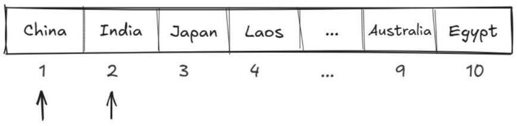
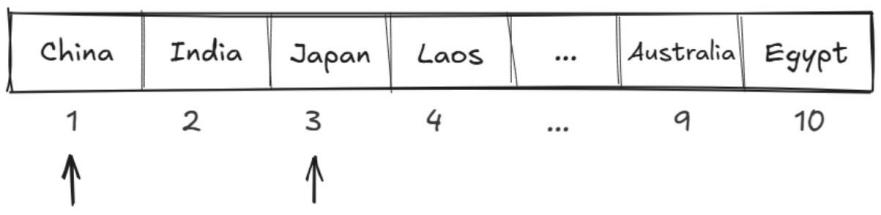
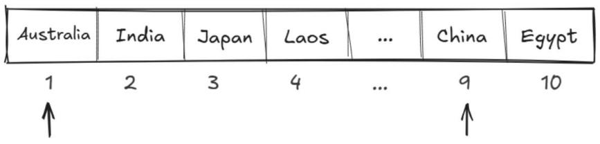
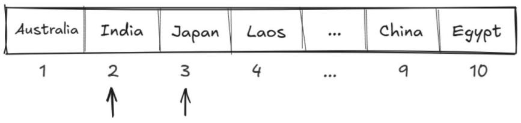

# 第 22 课：字符数组的基本操作

上节课我们已经学了 `cin.getline` 函数，它能够实现一个包含空格的字符串的读取，读取指定最多数量的字符，或者直到遇到换行符为止。

现在我们继续学习字符数组的格式化输入输出以及其他操作。

## 22.1 输入和输出

### 字符数组的输入

字符数组的输入可使用 scanf 函数（需要 cstdio 头文件）。

使用 scanf 语句可以输入多个字符串，%s 格式说明符可用于读取字符串，在碰到空格时停止读取。

输入单个字符串：

```cpp
scanf("%s", s1); // s1 表示字符数组名
```

输入多个字符串：

```cpp
scanf("%s%s%s", s1, s2, s3); // 输入多个字符串
```

示例代码：

```cpp
#include <iostream>
#include <cstdio> // 使用 scanf 需要添加的头文件
using namespace std;
int main()
{
    char str1[100], str2[100]; // 声明两个字符数组
    scanf("%s%s", str1, str2); // 输入两个不包含空格的字符串
    cout << str1 << " " << str2; // 输出这两个字符串，用空格隔开
    return 0;
}
```

### 字符数组的输出

字符数组的输出可使用 printf 函数（需要 cstdio 头文件）。

使用 printf 语句可以输出多个字符串，可在 printf 的格式字符串里使用多个 %s 占位符，然后依次列出对应的字符数组名。

输出单个字符串：

```cpp
printf("%s", s1); // 输出一个字符串
```

输出多个字符串：

```cpp
printf("%s %s %s", s1, s2, s3); // 输出三个字符串
```

需要注意以下两点。

1) 用 %s 格式输出时，printf 的输出项只能是字符串（字符数组）名称，而不能是数组元素。例如：`printf("%s", a[5]);` 是错误的。

2) 输出字符串不包括字符串结束标识符 `'\0'`。

示例代码：

```cpp
#include <iostream>
#include <cstdio>
using namespace std;
int main()
{
    char str1[100], str2[100];
    scanf("%s%s", str1, str2);
    printf("%s %s", str1, str2); // 输出之前输入的两个字符串，并用空格隔开
    return 0;
}
```

> 注：原书“输出多个字符串”示例的注释误写为“输出一个字符串”，此处已修正。

## 22.2 实例讲解

### 例 1：过滤多余空格

一个句子中也许有多个连续的空格，现要求你过滤掉多余的空格，只留下一个空格进行输出。

【输入格式】输入一行，一个字符串（长度不超过 200），句子的开头和结尾都没有空格。

【输出格式】输出一行，为过滤掉多余空格之后的句子。

【输入样例】

```
Hello      world . This is    c language .
```

【输出样例】

```
Hello world . This is c language .
```

**解析**

使用 scanf 函数只能一个一个读“单词”，不读空格，可以使用 `while (scanf("%s", st) == 1)`，它的功能是循环读入数据，在读不到的时候停止循环，代码如下：

```cpp
while (scanf("%s", st) == 1)
    printf("%s ", st);
```

> 注：原书解析中的示例写作 `scanf("%s", &st)`，当 st 为字符数组时应传入数组名本身，此处已按参考代码修正为 `scanf("%s", st)`。

**参考代码**

```cpp
#include <iostream>
#include <cstdio>
using namespace std;
char st[201];
int main()
{
    while (scanf("%s", st) == 1) // 输入到空格就结束，相当于过滤掉所有空格
        printf("%s ", st); // %s 后面有空格，每输出一个单词就多输出一个空格
    return 0;
}
```

### 例 2：替换文档

在应用计算机编辑文档的时候，我们经常遇到替换任务，例如把文档中的“电脑”都替换成“计算机”，现在请你编程模拟一下这个操作。

输入两行内容，第 1 行是原文（长度不超过 200 个字符），第 2 行包含以空格分隔的两个字符 a 和 b，要求将原文中所有的字符 a 都替换成字符 b，注意区分大小写字母。

【输入格式】输入两行，第 1 行包含一个字符串（长度不超过 200），中间有可能包含空格。第 2 行包含两个以空格隔开的字符 a 和 b。

【输出格式】输出一行，为将原文中所有的字符 a 都替换成字符 b 的字符串。

【输入样例】

```
I love China . I love Beijing .
I U
```

【输出样例】

```
U love China . U love Beijing .
```

**解析**

1) 首先要将给定的原文保存在字符串 s 内，注意输入的字符串可能包含空格，可以使用 `cin.getline` 函数。

2) 直接使用 cin 输入字符 a 和 b。

3) 在原文中，从头开始寻找字符 a，找到一个字符 a，便将其替换成字符 b，再继续寻找下一个字符 a，找到了就替换……直到将原文的所有字符都处理完。若 len 表示字符数组的长度、字符数组名为 s，则有：

```cpp
for (int i = 0; i < len; i++)
{
    if (s[i] == a) // 若找到字符 a
        cout << b; // 将其替换为字符 b
    else
        cout << s[i]; // 若不是字符 a 则原样输出
}
```

**参考代码**

```cpp
#include <iostream>
#include <cstdio>
#include <cstring>
using namespace std;
char s[201], a, b;
int main()
{
    cin.getline(s, 201);
    int len = strlen(s);
    cin >> a >> b;
    for (int i = 0; i < len; i++)
    {
        if (s[i] == a)
            cout << b;
        else
            cout << s[i];
    }
    return 0;
}
```

## 22.3 复制与比较

### strcpy“复制”函数

格式：

```cpp
strcpy(字符串 1, 字符串 2);
```

说明：将字符数组 2 的字符复制到字符数组 1 中，返回字符串 1 的值。

示例代码：

```cpp
char a[10], b[] = {"COPY"}; // 定义两个字符数组 a 和 b
strcpy(a, b); // 将 b 中的 COPY 复制到 a 中
```

### strcmp“比较”函数

格式：

```cpp
strcmp(字符串 1, 字符串 2);
```

说明如下。

1) 比较字符串 1 和字符串 2 的大小，比较的结果由函数带回：

a. 如果字符串 1 大于字符串 2，返回一个正整数；

b. 如果字符串 1 等于字符串 2，返回 0；

c. 如果字符串 1 小于字符串 2，返回一个负整数。

2) 判断两个字符串的大小，是在字符串中自左向右逐个字符按其 ASCII 值的大小进行比较，比如：

a. `"A" < "B"`，因为 B 的 ASCII 值是 66，A 是 65，所以 A 小于 B；

b. `"A" < "AB"`，因为第一个字符串 A 后面没有字符，第二个字符串多了个 B，所以后面的字符串大；

c. `"Apple" > "Aanana"`，首字母相等，比较第二个字母，第二个字母大的这个字符串大，所以前面一个字符串大。

注　以上两个函数均需要使用 cstring 头文件，即：`#include <cstring>`。

### 例 3：输出国家名

在国际交流日益频繁的今天，对国家名称进行有序管理和展示十分重要。蛙蛙想编写一个程序，对给定的国家名称列表进行排序处理，以便于后续的查询和展示，排序的规则是按其字母顺序。

【输入格式】输入一行，共 10 个国家名，用空格隔开（国家名的长度不超过 20 个字母）。

【输出格式】输出一行，按首字母大小顺序输出这十个国家名，若首字母相同，则对比第二个字母，以此类推，其中所有国家名均为首字母大写，其他字母为小写，不同国家用空格隔开。

【输入样例】

```
China India Japan Laos Kenya Malaysia Pakistan Maldives Australia Egypt
```

【输出样例】

```
Australia China Egypt India Japan Kenya Laos Malaysia Maldives Pakistan
```

**解析**

下面以输入样例为例进行讲解。

1) 从第一个国家开始，与后面的国家一个个比较，如果字符串 1 大于字符串 2，则将字符串 1 与字符串 2 互换位置，由于 "China" 小于 "India"，所以不互换（见图 4-6）。

图 4-6　输出国家名解析 1



2) 接下来第一个国家继续与第三个国家相比较，如果字符串 1 大于字符串 3，则将字符串 1 与字符串 3 互换位置，由于 "China" 小于 "Japan"，依旧不互换（见图 4-7）。

图 4-7　输出国家名解析 2



3) 当第一个国家与第九个国家相比较时，发现字符串 1 大于字符串 9，所以要将字符串 1 与字符串 9 互换位置，所以当前 "Australia" 的下标数字为 1，"China" 的下标数字为 9（见图 4-8）。

图 4-8　输出国家名解析 3



4) 当第一个国家与最后一个国家比较完之后，以第二个国家为参考点，接着让它与第三、第四，一直到最后一个国家相比较。如果字符串 2 大于后面的字符串，则将字符串 2 与后面小的字符串互换位置，一直比到最后一个国家（见图 4-9）。

图 4-9　输出国家名解析 4



**参考代码**

```cpp
#include <iostream>
#include <cstring>
using namespace std;
int main()
{
    char t[21], cname[11][21]; // cname 二维数组用于保存多个国家的国家名
    for (int i = 1; i <= 10; i++)
        cin >> cname[i]; // 输入第 i 个国家的国家名
    for (int i = 1; i <= 9; i++)
    {
        int k = i;
        for (int j = i + 1; j <= 10; j++)
            if (strcmp(cname[k], cname[j]) > 0) // 当前国家名大
                k = j;
        strcpy(t, cname[i]);
        strcpy(cname[i], cname[k]);
        strcpy(cname[k], t); // 将小的国家名更新到当前位置
    }
    for (int i = 1; i <= 10; i++)
        cout << cname[i] << " ";
    return 0;
}
```

### 例 4：字符串判等

判断两个由大小写字母和空格组成的字符串在忽略大小写且忽略空格的情况下是否相等。

【输入格式】输入两行，每行包含一个字符串。

【输出格式】输出一行，若两个字符串在忽略大小写且忽略空格的情况下相等，则输出 YES，否则输出 NO。

【输入样例】

```
a A bb BB ccc CCC
Aa BBbb CCCccc
```

【输出样例】YES

**解析**

1) 输入两行字符串，分别存储到字符数组 s1 和 s2 中。

2) 利用 for 循环遍历字符串中的每一个字符，将两个字符串中的所有大写字母转换为小写字母。

3) 再判断当前字符是不是空格，如果不是空格，则将其添加到新的字符数组中。

4) 通过 strcmp 函数比较两个字符串是否相等，如果相等（返回 0）则输出 YES，否则输出 NO。

**参考代码**

```cpp
#include <iostream>
#include <cstring>
using namespace std;
const int N = 256;
char s1[N], s2[N], a[N], b[N];
int l1, l2;
int main()
{
    cin.getline(s1, N);
    cin.getline(s2, N);
    for (int i = 0; i < strlen(s1); i++)
    {
        // 将大写字母全部转换成小写字母
        if (s1[i] >= 'A' && s1[i] <= 'Z')
            s1[i] += 32;
        // 删除字符串中所有空格
        if (s1[i] != ' ')
            a[l1++] = s1[i];
    }
    for (int i = 0; i < strlen(s2); i++)
    {
        if (s2[i] >= 'A' && s2[i] <= 'Z')
            s2[i] += 32;
        if (s2[i] != ' ')
            b[l2++] = s2[i];
    }
    if (strcmp(a, b) == 0)
        cout << "YES" << endl;
    else
        cout << "NO" << endl;
    return 0;
}
```
