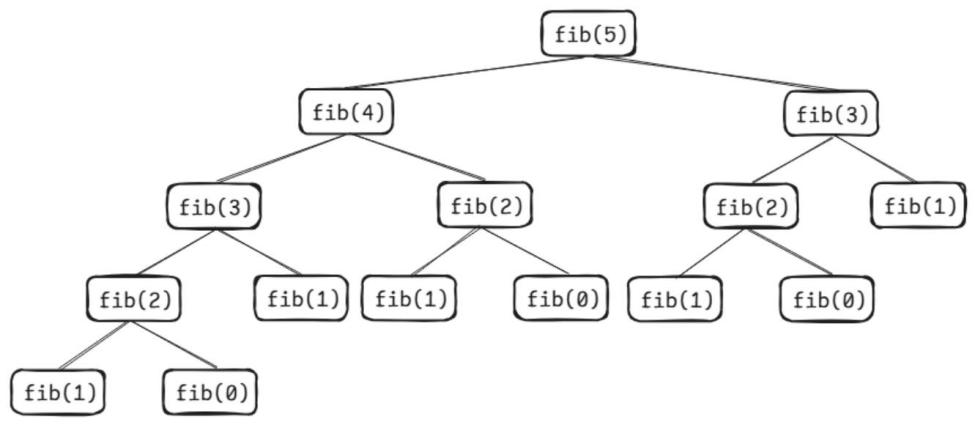

# 第 42 课：动态规划

动态规划方法将问题分解为一组更简单的子问题，在求解每个子问题时，会将子问题的解保存起来，在后面遇到相同的子问题时避免重复计算，利用空间换时间。

可以采用动态规划方法的问题主要有以下特征。

1) 多段决策：问题可以按顺序分解成若干相互联系的子问题，每个子问题都需要做出决策。

2) 最优子结构：当前问题的最优解可以由子问题的最优解得到。

3) 无后效性：某阶段的状态一旦确定，则此后过程的演变不再受此前各种状态及决策的影响。

## 42.1 记忆化搜索

斐波那契数列的定义为：F(0) = 0，F(1) = 1，F(n) = F(n − 1) + F(n − 2)（n ≥ 2 时）。

### 递归求斐波那契数列

我们先通过递归来求解斐波那契数列的第 n 项。如果 n 小于 2，返回 n 本身，即 F(0) = 0，F(1) = 1；如果 n ≥ 2，返回 F(n) = F(n − 1) + F(n − 2)。代码如下：

```cpp
#include <iostream>
using namespace std;
// 递归函数计算斐波那契数列
int fib(int n)
{
    if (n <= 1)
        return n;
    else
        return fib(n - 1) + fib(n - 2);
}
int main()
{
    int n;
    cin >> n;
    cout << fib(n);
    return 0;
}
```

运行后输入：

```
5
```

输出结果：

```
5
```

虽然通过递归能求出斐波那契数列的第 n 项，但程序时间复杂度极高，比如我们要求 fib(5)，就必须先求出 fib(4) 和 fib(3)，求 fib(4) 时还需要再调用一次 fib(3)，这里 fib(3) 就需要再求一次。我们会发现有很多值需要多次计算。

通过图 9-1 我们可以观察到，fib(3) 被求解了两次。每次求 fib(3) 还需要再求一次 fib(2)，求解 fib(5) 就需要求解三次 fib(2)、两次 fib(3)。若想要求解 fib(6)，则需要多求一次 fib(4)，而要求一次 fib(4) 就需要再求一次 fib(3)，两次 fib(2)。

图 9-1　递归求斐波那契数列演示



图中节点数量近似于等比数列求和，递归算法的时间复杂度会达到 O(2ⁿ)，呈指数级增长。比如要求 fib(50)，时间复杂度近似于 2⁵⁰，即接近 1125899906842624，这种计算方法在考试中一定超时，必须对其进行优化。

### 记忆化搜索优化程序

如果我们在计算的过程中，将 fib(n) 的结果保存到 dp[n] 数组中，借此避免重复计算，让每个值只需要求一次，那么时间复杂度将会被优化成线性的 O(n)，这种思路就是记忆化搜索。

它的核心思想是通过一个额外的数据结构（通常是数组）来记录已经计算过的子问题的解。当需要再次计算某个子问题时，首先检查该子问题的解是否已经存在于记录中，如果存在则直接使用记录中的结果，避免重复计算，从而显著提高算法的效率。优化后的代码如下：

```cpp
#include <iostream>
using namespace std;
int dp[110];
int fib(int n)
{
    if (n == 0)
        return dp[n] = 0;
    if (n == 1 || n == 2)
        return dp[n] = 1;   // 将 1 记忆在 dp[n]中并返回
    if (dp[n])
        return dp[n];       // 如果计算完毕则返回
    return dp[n] = fib(n - 2) + fib(n - 1);
}
int main()
{
    int n;
    cin >> n;
    cout << fib(n);
    return 0;
}
```

## 42.2 动态规划

记忆化搜索是一种自顶向下的递归方法，它在递归过程中记录已经计算过的子问题的解，避免重复计算。还有一种自底向上的方法，从最小的子问题开始，逐步计算出更大规模的子问题的解，直到得到最终问题的解，我们称之为动态规划。

### 参考代码

```cpp
#include <iostream>
using namespace std;
int dp[110];
int fib(int n)
{
    // 初始化最小子问题的解
    dp[0] = 0;
    dp[1] = 1;
    // 从最小子问题开始，逐步计算更大规模的子问题
    for (int i = 2; i <= n; i++)
    {
        dp[i] = dp[i - 1] + dp[i - 2];
    }
    return dp[n];
}
int main()
{
    int n;
    cin >> n;
    cout << fib(n);
    return 0;
}
```

这个算法会从小到大计算斐波那契数列，所以计算 dp[i]（i ≥ 2）时，程序在此之前就已经完成了 dp[i − 1] 和 dp[i − 2] 的计算。

与记忆化搜索相比，动态规划避免了递归调用带来的额外开销，让代码更加简洁，并且在某些情况下可以进一步优化空间复杂度。例如，在计算斐波那契数列时，实际上只需要保存前两个状态（dp[i − 1] 和 dp[i − 2]）的值，因此可以将空间复杂度优化到 O(1)。

## 42.3 实例讲解

### 例 1：数字三角形

观察下面的数字三角形，写一个程序来查找从最高点到底部任意处结束的路径，使路径经过数字的和最大，每一步可以走到正下方的点也可以走到右下方的点。

```text
7
3 8
8 1 0
2 7 4 4
4 5 2 6 5
```

在上面的样例中，从 7 到 3 到 8 到 7 到 5 的路径产生了最大的和，为 30。

【输入格式】输入 n + 1 行。第 1 行包含一个整数 n，表示数字三角形的行数。接下来的 n 行，第 i 行包含 i 个整数，表示数字三角形第 i 行的数字。

【输出格式】输出一行，一个整数，表示从最高点到底部任意处结束的路径经过数字的最大和。

【输入样例】

```
5
7
3 8
8 1 0
2 7 4 4
4 5 2 6 5
```

【输出样例】

```
30
```

【数据范围】数字三角形的行数 n 满足 1 ≤ n ≤ 1000。

数字三角形中的每个数字 aᵢⱼ 满足 0 ≤ aᵢⱼ ≤ 100。

看完这个题目，蛙蛙想到了之前所学的深度优先搜索：可以从数字三角形的最高点开始搜索，也就是位置 (1, 1)，初始路径上数字之和为该点的值 a[1][1]，再设定一个变量 ans 用于记录路径上数字之和的最大值，初始值为 0。

1) 若当前所在行 x 等于数字三角形的总行数 n，意味着搜索到了最后一行。此时将当前路径上数字之和 sum 与 ans 进行比较，把较大值赋给 ans，然后返回，结束当前分支的搜索。

2) 若当前行 x 不等于 n，则有两个可能的下一步方向，一是向正下方搜索，二是向右下方搜索。

代码如下：

```cpp
#include <iostream>
using namespace std;
int a[1001][1001], ans, n;
void dfs(int x, int y, int sum) // 表示到达 a[x][y]的路径上数字之和为 sum
{
    if (x == n) // 对最后一行的所有结果求最大值 ans
    {
        ans = max(sum, ans);
        return;
    }
    dfs(x + 1, y, sum + a[x + 1][y]);         // 到达正下方的位置
    dfs(x + 1, y + 1, sum + a[x + 1][y + 1]); // 到达右下方的位置
}
int main()
{
    cin >> n;
    for (int i = 1; i <= n; i++)
        for (int j = 1; j <= i; j++)
            cin >> a[i][j];
    dfs(1, 1, a[1][1]); // 从(1,1)开始搜索
    cout << ans;
    return 0;
}
```

由于要遍历从最高点到底部的所有可能路径，该算法的时间复杂度为 O(2ⁿ)，这里的 n 是数字三角形的行数。当 n 较大时，该算法的效率会很低，在考试中也会超时，可以用动态规划的方法对其进行优化。

### 动态规划法优化

1) 先确定问题中的状态

定义 dp[i][j] 为从数字三角形的第 n 行（也就是最后一行）出发，到达位置 (i, j) 时路径上数字之和的最大值。这里的 (i, j) 表示数字三角形中第 i 行的第 j 个元素。

2) 状态转移公式

因为路径是连续的，从最后一行到 (i, j) 的数字之和最大的路径必然要经过 (i + 1, j) 或者 (i + 1, j + 1)，所以，从最后一行到 (i, j) 的路径上数字之和的最大值就等于当前位置 (i, j) 的数字 a[i][j] 加上从最后一行到 (i + 1, j) 和 (i + 1, j + 1) 的路径上数字之和的最大值中的较大值，即：

```text
dp[i][j] = a[i][j] + max(dp[i + 1][j], dp[i + 1][j + 1])
```

3) 找到问题的边界

当处于最后一行（即 i = n）时，从最后一行到自身的路径上数字之和的最大值就是该位置的数字本身，所以：

```text
dp[n][i] = a[n][i]
```

4) 动态转移过程分析

a. 初始化：初始化边界条件，把 dp 数组的最后一行初始化为数字三角形最后一行的对应元素，即 dp[n][i] = a[n][i]，如表 9-18 所示。

表 9-18　初始化边界条件

| i\j | 1 | 2 | 3 | 4 | 5 |
|-----|---|---|---|---|---|
| 1   |   |   |   |   |   |
| 2   |   |   |   |   |   |
| 3   |   |   |   |   |   |
| 4   |   |   |   |   |   |
| 5   | 4 | 5 | 2 | 6 | 5 |

b. 状态转移：从倒数第二行（i = n − 1）开始，逐步向上递推，依据状态转移公式 dp[i][j] = a[i][j] + max(dp[i + 1][j], dp[i + 1][j + 1]) 计算每个位置的路径上数字之和的最大值，如表 9-19 到表 9-22 所示。

表 9-19　根据状态转移方程推出第 4 行的值

| i\j | 1 | 2  | 3  | 4  | 5 |
|-----|---|----|----|----|---|
| 1   |   |    |    |    |   |
| 2   |   |    |    |    |   |
| 3   |   |    |    |    |   |
| 4   | 7 | 12 | 10 | 10 |   |
| 5   | 4 | 5  | 2  | 6  | 5 |

表 9-20　根据状态转移方程推出第 3 行的值

| i\j | 1  | 2  | 3  | 4 | 5 |
|-----|----|----|----|---|---|
| 1   |    |    |    |   |   |
| 2   |    |    |    |   |   |
| 3   | 20 | 13 | 10 |   |   |
| 4   | 7  | 12 | 10 | 10 |  |
| 5   | 4  | 5  | 2  | 6 | 5 |

表 9-21　根据状态转移方程推出第 2 行的值

| i\j | 1  | 2  | 3  | 4  | 5 |
|-----|----|----|----|----|---|
| 1   |    |    |    |    |   |
| 2   | 23 | 21 |    |    |   |
| 3   | 20 | 13 | 10 |    |   |
| 4   | 7  | 12 | 10 | 10 |   |
| 5   | 4  | 5  | 2  | 6  | 5 |

表 9-22　根据状态转移方程推出第 1 行的值

| i\j | 1  | 2  | 3  | 4  | 5 |
|-----|----|----|----|----|---|
| 1   | 30 |    |    |    |   |
| 2   | 23 | 21 |    |    |   |
| 3   | 20 | 13 | 10 |    |   |
| 4   | 7  | 12 | 10 | 10 |   |
| 5   | 4  | 5  | 2  | 6  | 5 |

c. 输出结果：dp[1][1] 就代表从最后一行到最高点 (1, 1) 的路径上数字之和的最大值，也就是问题的答案。

### 参考代码

```cpp
#include <iostream>
using namespace std;
int a[1001][1001];
int dp[1001][1001], ans;
// dp[i][j]表示从第n行到 a[i][j]的最大值
// dp[i][j]可以由 dp[i + 1][j],dp[i + 1][j + 1]的值推出
// dp[i][j] = a[i][j] + max(dp[i + 1][j], dp[i + 1][j + 1])
int main()
{
    int n;
    cin >> n;
    for (int i = 1; i <= n; i++)
        for (int j = 1; j <= i; j++)
            cin >> a[i][j];
    for (int i = 1; i <= n; i++)
        dp[n][i] = a[n][i];              // 初始化边界条件
    for (int i = n - 1; i >= 1; i--)     // 从第 n - 1 行开始
        for (int j = 1; j <= i; j++)
            dp[i][j] = a[i][j] + max(dp[i + 1][j], dp[i + 1][j + 1]);
    cout << dp[1][1];
    return 0;
}
```

### 例 2：最长上升子序列

给定一整型数列 {a₁, a₂, …, aₙ}（0 < n ≤ 500），找出最长上升子序列，并求出其长度。

如：1 9 10 5 11 2 13 的最长上升子序列是 1 9 10 11 13，长度为 5。

【输入格式】输入两行，第 1 行输入一个整数 n，第 2 行输入 n 个整数。

【输出格式】输出一行，为最长的上升子序列的长度。

【输入样例】

```
7
1 9 10 5 11 2 13
```

【输出样例】

```
5
```

**解析**

子序列：给定一个序列，子序列是从原序列中删除一些元素（也可以不删除元素）但不改变剩余元素的顺序而得到的新序列。例如，对于序列 {1, 2, 3, 4, 5} 而言，{1, 3, 5}、{2, 4} 和 {1, 2, 3, 4, 5} 由于元素顺序没有改变，所以都是它的子序列，但 {2, 4, 3} 就不是它的子序列，因为原序列中 3、4 的位置在这里改变了。

对于本题：

1) 先定义状态：我们定义 dp[i] 表示前 i 项中包含第 i 项的最长上升子序列的长度。

2) 初始状态：对于每一个单独的元素 a[i]，它自身就可以构成一个长度为 1 的上升子序列。所以，我们将 dp[i] 的初始值都设为 1，即：

```cpp
for (int i = 1; i <= n; i++) dp[i] = 1;
```

3) 状态转移方程

为了得到 dp[i] 的值，我们需要考虑前 i − 1 个元素的情况，对于每一个 j（1 ≤ j < i），我们检查 a[j] 和 a[i] 的大小关系。

a. 如果 a[j] < a[i]，这意味着第 i 个元素 a[i] 可以连接在第 j 个元素 a[j] 后面，形成一个更长的上升子序列。

b. 如果 a[j] ≥ a[i]，那么 a[i] 不能连接在 a[j] 后面形成上升子序列，所以 dp[j] 对于计算 dp[i] 没有贡献。

为了得到 dp[i] 的最大值，我们需要遍历所有的 j，并取 dp[i] 和 dp[j] + 1 中的较大值。因此，状态转移方程为：

```text
dp[i] = max(dp[i], dp[j] + 1)，其中 1 ≤ j < i 且 a[j] < a[i]
```

4) 最终结果

遍历完整个数列后，dp[i] 表示的是以 a[i] 结尾的最长上升子序列的长度。为了得到整个数列的最长上升子序列的长度，我们需要找出所有 dp[i]（1 ≤ i ≤ n）中的最大值，可以使用变量 mx 来记录这个最大值，在每次更新 dp[i] 时，同时更新 mx，即：

```text
mx = max(dp[i], mx);
```

**参考代码**

```cpp
#include <iostream>
#include <algorithm>
using namespace std;
int a[505], dp[505];
// dp[i] 表示前 i 项中包含第 i 项的最长子序列
// 初始状态 dp[i] = 1;
// 包含第 i 项的最长子序列，可以由前面的 j 项的最长子序列得出
// 如果 a[j] < a[i]，dp[i] = max(dp[i], dp[j] + 1)
int main()
{
    int t, n, mx;
    cin >> n;
    mx = 1; // 边界初始化
    for (int i = 1; i <= n; i++)
    {
        cin >> a[i];
        dp[i] = 1;
    }
    for (int i = 1; i <= n; i++)
    {
        // 从 1~i-1 项去找
        for (int j = 1; j < i; j++)
        {
            // 如果 a[j] < a[i]，则说明 a[i]可以连接在 a[j]后面
            if (a[i] > a[j])
            {
                // 此时 dp[i]可能会变长
                dp[i] = max(dp[i], dp[j] + 1);
                mx = max(dp[i], mx);
            }
        }
    }
    cout << mx;
    return 0;
}
```
