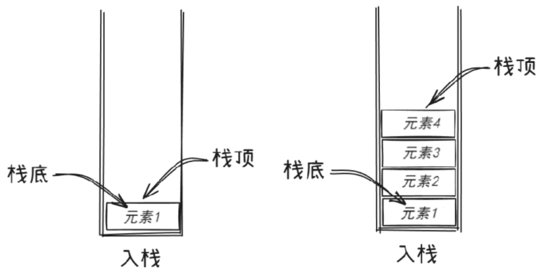
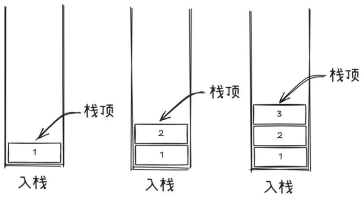
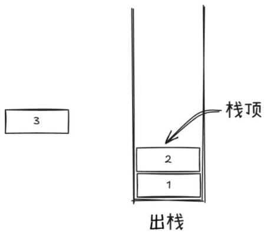
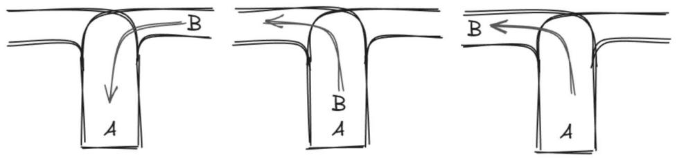

# 第 43 课：栈及其应用

数据结构是在程序中系统化管理数据集合的形式。 

它通常由以下 3 个概念组合而成。

- 数据集合：通过对象数据的本体（例如数组和结构体）保存数据集合。
- 规则：保证对数据集合进行正确操作、管理和保存的规则（例如按照顺序取出数据）。
- 操作：增、删、改、查等对数据集合的操作。

## 43.1 栈的定义、特点和操作

### 定义

栈是一种特殊的线性表，它只能在表的一端（称为栈顶）进行插入和删除操作（见图 10-1）。

图 10-1　栈



用一个简单的例子来说，栈就像一个放乒乓球的圆筒，底部是封住的，如果想拿出乒乓球，只能从顶部拿。同样，如果想再将乒乓球放回去，也只能从顶部放入其中。

当然生活中还有很多这样的例子，再比如食堂中的一叠盘子，我们只能从顶端一个一个地取，放盘子也只能放在最上方。

### 特点

遵循后进先出（Last In First Out，LIFO）的原则，即先进栈的元素要在后进栈的元素取出来之后才能取出来。

### 操作

入栈（push）：将元素添加到栈顶。例如，有一个空栈，依次让元素 1、2、3 入栈，那么栈顶元素是 3，栈底元素是 1（见图 10-2）。入栈有时也称"压入"。

图 10-2　入栈



出栈（pop）：从栈顶移除元素。对于刚才的栈，执行出栈操作，先移除的是 3，此时栈顶元素变为 2（见图 10-3）。

图 10-3　出栈



获取栈顶元素（top）：可以查看栈顶元素的值，但不进行删除操作。

判断栈是否为空（isEmpty）：用于检查栈中是否还有元素。

## 43.2 STL 中栈的基本使用

STL 即标准模板库（Standard Template Library），它是 C++ 标准库的一个重要组成部分，提供了一系列通用的模板类和函数。

本节中，我们只针对栈来讲解如何利用 STL 实现栈的相关操作。

需要添加头文件：`#include <stack>`。

创建一个存放 int 类型的空栈 s：`stack<int> s;`。

1) s.empty()：判断栈是否为空，为空则返回 true，否则返回 false。

2) s.size()：返回栈中元素的个数。

3) s.top()：获取栈顶元素的值。

4) s.push(k)：向栈中添加新的元素 k。

5) s.pop()：删除栈 s 的栈顶元素。

## 43.3 实例讲解

### 例 1：括号匹配

给定一个字符串，里边可能包含 ()、[] 和 {} 三种括号，请编写程序检查该字符串的括号是否匹配出现，匹配说明嵌套关系正确，例如 {[()]}() 是匹配的，而 )({)[}]( 则不匹配。匹配则输出 YES，否则输出 NO。

【输入格式】输入一行，一个字符串，例如 (1+2)/(0.5+1)。

【输出格式】输出一行，如果字符串匹配，则输出 YES，否则输出 NO。

【输入样例】

```
(1+2)/[(0.5+1)*2]
```

【输出样例】

```
YES
```

**解析**

样例分析

输入 (1+2)/[(0.5+1)*2]：

```text
( 入栈 → 栈：(
[ 入栈 → 栈：[ (
] 匹配 [ → 栈：(
) 匹配 ( → 栈空 → YES
```

1) 核心思想：括号匹配问题可利用栈的后进先出特性。

a. 左括号 (、[、{ 必须按顺序入栈，等待匹配。

b. 右括号 )、]、} 必须与最近入栈的左括号（即栈顶元素）匹配，否则不合法。

2) 遇到左括号 (、[、{ 时，执行进栈（push）操作，主要是记录未匹配的左括号，等待后续右括号匹配。即：

```cpp
if (a[i] == '(' || a[i] == '[' || a[i] == '{')
{
    s.push(a[i]); // 左括号入栈
}
```

3) 遇到右括号 )、]、} 时执行出栈（pop）操作。

若栈为空，说明右括号无匹配的左括号，直接返回 NO，即：

```cpp
if (s.empty())
{
    cout << "NO" << endl;
    return 0;
}
```

4) 弹出栈顶元素：取出最近未匹配的左括号，检查括号类型是否匹配，若不匹配则直接输出 NO。代码如下：

```cpp
char top = s.top();
s.pop();
// 检查括号类型是否匹配
if ((a[i] == ')' && top != '(') ||
    (a[i] == ']' && top != '[') ||
    (a[i] == '}' && top != '{'))
{
    cout << "NO" << endl;
    return 0;
}
```

5) 遍历结束后：若栈为空，说明所有左括号均被匹配；否则存在未匹配的左括号。代码如下：

```cpp
if (s.empty())
    cout << "YES" << endl;
else
    cout << "NO" << endl;
```

**参考代码**

```cpp
#include <iostream>
#include <stack>
using namespace std;
int main()
{
    stack<char> s;
    string a;
    cin >> a;
    for (int i = 0; i < a.size(); i++)
    {
        if (a[i] == '(' || a[i] == '[' || a[i] == '{')
        {
            s.push(a[i]); // 左括号入栈
        }
        else if (a[i] == ')' || a[i] == ']' || a[i] == '}')
        {
            if (s.empty())
            { // 栈为空说明右括号无匹配
                cout << "NO" << endl;
                return 0;
            }
            char top = s.top();
            s.pop();
            // 检查括号类型是否匹配
            if ((a[i] == ')' && top != '(') ||
                (a[i] == ']' && top != '[') ||
                (a[i] == '}' && top != '{'))
            {
                cout << "NO" << endl;
                return 0;
            }
        }
    }
    if (s.empty())
        cout << "YES" << endl;
    else
        cout << "NO" << endl;
    return 0;
}
```

### 例 2：逆波兰表达式

逆波兰表达式又称后缀表达式，它不包含括号，运算符（包括 +、-、*、/）放在两个运算对象的后面，所有的计算按运算符出现的顺序，严格从左向右进行（不再考虑运算符的优先规则），如：(2 + 1) * 3 表示为 2 1 + 3 *。

利用栈结构，将一位数的后缀表达式的结果计算出来。

【输入格式】输入一行，一个逆波兰表达式，字符用空格隔开，仅计算一位数且一定是有效运算（出现除数为 0 或者操作符为其他符号的情况视为无效运算）。

【输出格式】输出一行，为算式结果。

【输入样例】

```
2 1 + 3 *
```

【输出样例】

```
9
```

**解析**

样例分析（输入 2 1 + 3 *）：

```text
读取 2，入栈 → 栈：2
读取 1，入栈 → 栈：2, 1
读取 +，弹出 1 和 2，计算 2 + 1 = 3，入栈 → 栈：3
读取 3，入栈 → 栈：3, 3
读取 *，弹出 3 和 3，计算 3 * 3 = 9，入栈 → 栈：9
输出栈顶元素：9
```

**参考代码**

```cpp
#include <iostream>
#include <stack>
using namespace std;
int main()
{
    int t, k;
    char c;
    stack<int> s;
    while (cin >> c)
    {
        if (c >= '0' && c <= '9')
            s.push(c - '0'); // 如果是数字，就入栈
        if (c == '+')
        {
            t = s.top();   // 获取栈顶数字
            s.pop();       // 出栈
            k = s.top();   // 获取新的栈顶
            s.pop();       // 出栈
            s.push(t + k); // 相加结果入栈
        }
        if (c == '-')
        {
            t = s.top();   // 获取栈顶数字
            s.pop();       // 出栈
            k = s.top();   // 获取新的栈顶
            s.pop();       // 出栈
            s.push(k - t); // 相减结果入栈
        }
        if (c == '*')
        {
            t = s.top();
            s.pop();
            k = s.top();
            s.pop();
            s.push(t * k); // 相乘结果入栈
        }
        if (c == '/')
        {
            t = s.top();
            s.pop();
            k = s.top();
            s.pop();
            s.push(k / t); // 相除结果入栈
        }
    }
    cout << s.top();
    return 0;
}
```

程序仅针对一位数的四则运算，且除数不为 0。还要注意，由于 while (cin >> c) 的循环输入，所以输出结束时还需要按 Ctrl+Z 键使 cin 进入结束状态。

### 例 3：火车问题

随着新学期的到来，很多学生选择乘坐火车返校，火车站现在非常繁忙。

但是现在有一个问题：整个车站只有一条铁路可以停靠所有的到站列车，所以所有列车都从一侧进站，从另一侧出站。如图 10-4 所示，如果火车 A 先进站，然后火车 B 在火车 A 出站之前进站，则在火车 B 出站之前，火车 A 不能出站。

图 10-4　火车进出站

 

车站最多有 9 趟列车，所有列车都有一个 ID（编号从 1 到 N），列车按照 O1 的顺序进站，你的任务是判断列车是否可以按照 O2 的顺序出站。

【输入格式】输入包含多个测试案例。

每个测试案例包括一个整数 N，表示列车数量，还有两个字符串 O1 和 O2，表示列车的顺序。

【输出格式】如果列车无法按照 O2 的顺序出站，输出一行字符串 No.。如果可以按照 O2 的顺序出站，输出一行字符串 Yes.，然后输出火车进出的顺序，in 表示进站，out 表示出站。

在每个测试案例后打印包含 FINISH 的行。

【输入样例】

```
3 123 321
3 123 312
```

【输出样例】

```
Yes.
in
in
in
out
out
out
FINISH
No.
FINISH
```

**解析**

初始化一个空栈和分别指向字符串 O1 和 O2 的指针（初始为 0）。

遍历 O1 中的每个列车：将当前列车压入栈中，并记录 in 操作。

检查栈顶元素是否与 O2 的当前元素相同：如果相同，弹出栈顶元素，记录 out 操作，并移动 O2 的指针。重复此检查直到栈顶元素与 O2 当前元素不同或栈为空。

如果 O1 的所有列车都已处理完，但栈不为空：检查栈中剩余元素是否能按顺序弹出，与 O2 的剩余部分匹配。如果不能，则输出 No.。如果所有 O2 的元素都能按顺序匹配，则输出 Yes. 和操作序列。

**参考代码**

```cpp
#include <iostream>
#include <stack>
using namespace std;
int main()
{
    stack<char> s;
    int n, ans[101]; // ans 存放操作过程，1 表示入栈，0 表示出栈
    string O1, O2;
    int i, j, k; // k 存放操作个数
    while (cin >> n >> O1 >> O2)
    {
        i = 0;
        j = 0;
        k = 1;
        s.push(O1[0]); // 防止空栈，先压入一个
        ans[0] = 1;
        while (i < n && j < n)
        {
            if (s.size() && s.top() == O2[j])
            {
                j++; // 解决一个后，接着往后解决
                s.pop();
                ans[k++] = 0;
            }
            else // 如果不相同，继续将 O1 后一个元素压入
            {
                if (i == n) // 都找过了还不满足，则不行
                    break;
                s.push(O1[++i]); // 提前压入了一个，所以++i
                ans[k++] = 1;
            }
        }
        if (i == n) // i == n 代表找不到 O2 中的当前元素
            cout << "No." << endl;
        else
        {
            cout << "Yes." << endl;
            for (i = 0; i < k; i++)
            {
                if (ans[i])
                    cout << "in" << endl;
                else
                    cout << "out" << endl;
            }
        }
        cout << "FINISH" << endl;
    }
    return 0;
}
```
