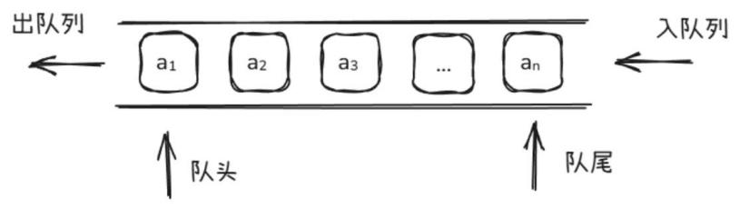
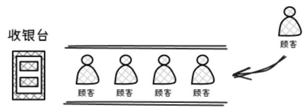
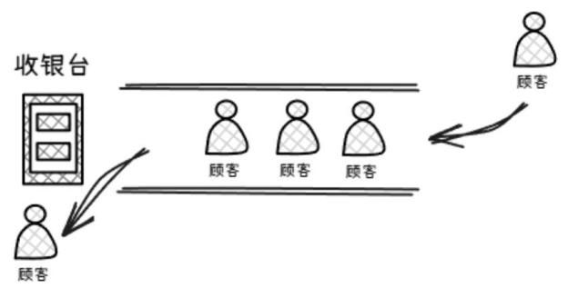
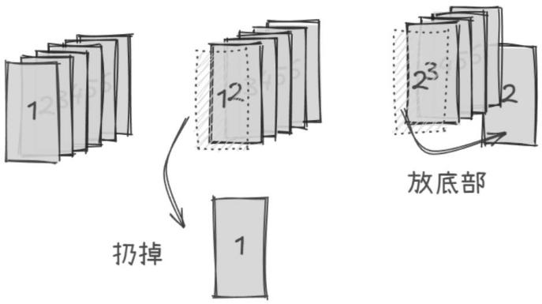
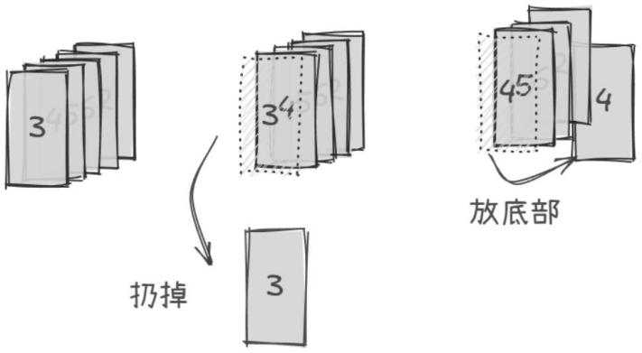
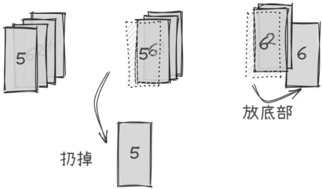
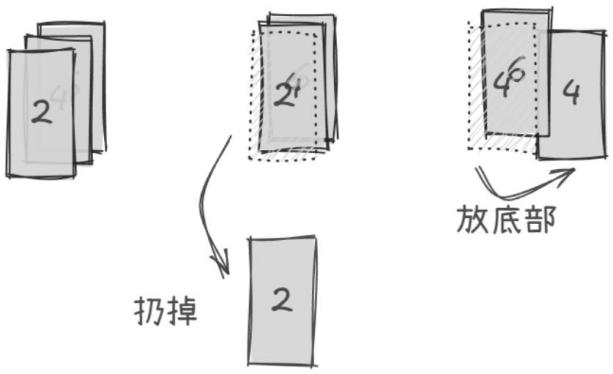
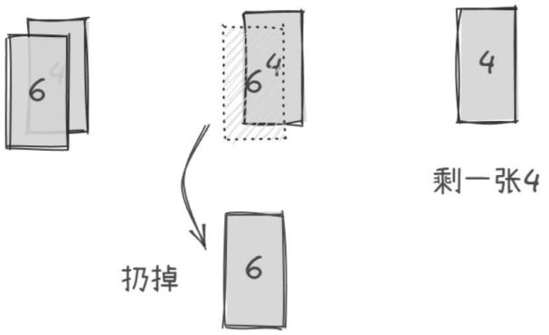

# 第 44 课：队列及其应用

## 44.1 队列的定义和特点

### 定义

队列是一种特殊的线性表，它只允许在表的前端（front）进行删除操作，而在表的后端（rear）进行插入操作，前端一般叫作队头，后端叫队尾。

就像学校做操站队一样，来的人一个一个往后站，走的时候从前往后一个一个走（见图 10-5）。

图 10-5　队列



### 特点

队列具有先进先出（First In First Out，FIFO）特性，只能在队头删除、队尾插入元素。它是一种线性、动态且具备可扩展性的数据结构。

## 44.2 数组模拟队列

### 数组模拟队列的基本操作

我们先利用数组来模拟队列的基本操作，具体实现如下。

1) 创建队列

```cpp
int que[105];            // 定义一个能存放 105 个数的数组来模拟队列
int front = 0, rear = 0; // front 与 rear 分别表示队头元素和队尾元素的位置
```

2) 空队条件：front == rear;

3) 元素入队：

```cpp
que[rear++] = x; // 元素 x 入队
```

4) 元素出队：

```cpp
x = que[front++]; // 队头元素出队，并将元素值赋值给 x
```

### 模拟超市收银问题

假设有一批顾客来到超市，在结账时，必须排队付款，先到达收银台的顾客先结账。我们模拟收银过程，使用队列来实现。一般队列会提供以下几个功能。

push(x)：将 x 压入队列，即顾客来排队，应该站在队尾（见图 10-6）。

图 10-6　顾客在队尾排队



pop：弹出队头元素，即排在最前面的人结完账后，离开队列（见图 10-7）。

图 10-7　顾客付款后从队头离开



front：查询队头元素，即搞清楚目前是谁在结账。

### 例 1：扔纸牌

桌上有一叠纸牌，一共有 N 张，从上到下编号依次为 1 ~ N（顶部的编号为 1，底部的编号为 N）。

只要这叠纸牌里至少还有两张牌，就执行以下操作：扔掉顶部的那张牌，然后把现在位于顶部的牌移动到这叠牌的底部。

你的任务是：当只剩下一张牌时，输出扔掉的牌的编号序列以及最后剩下的牌的编号。

【输入格式】输入多行，每行一个整数 N，表示这叠纸牌的张数（N ≤ 50）。

输入为 0 表示输入结束。

【输出格式】对于每一个 N，都输出两行（参考输出样例）。

第 1 行（Discarded cards）表示过程中扔掉的纸牌的编号序列，第 2 行（Remaining card）表示最后剩下的牌的编号。

【输入样例】

```
7
19
10
6
0
```

【输出样例】

```
Discarded cards: 1, 3, 5, 7, 4, 2
Remaining card: 6
Discarded cards: 1, 3, 5, 7, 9, 11, 13, 15, 17, 19, 4, 8, 12, 16, 2, 10, 18, 14
Remaining card: 6
Discarded cards: 1, 3, 5, 7, 9, 2, 6, 10, 8
Remaining card: 4
Discarded cards: 1, 3, 5, 2, 6
Remaining card: 4
```

**解析**

为了完成这个题目，蛙蛙拿来了一叠纸牌用来模拟扔纸牌的操作，每次先扔掉顶部的牌，接着把新的顶部牌移到这叠牌的底部，直至只剩一张牌。蛙蛙先用 6 张牌来模拟。

1) 扔掉纸牌 1，然后将纸牌 2 放入底部（见图 10-8）。

图 10-8　扔掉纸牌 1 后将纸牌 2 放入底部



2) 扔掉纸牌 3，然后将纸牌 4 放入底部（见图 10-9）。

图 10-9　扔掉纸牌 3 后将纸牌 4 放入底部



3) 扔掉纸牌 5，然后将纸牌 6 放入底部（见图 10-10）。

图 10-10　扔掉纸牌 5 后将纸牌 6 放入底部



4) 扔掉纸牌 2，然后将纸牌 4 放入底部（见图 10-11）。

图 10-11　扔掉纸牌 2 后将纸牌 4 放入底部



5) 扔掉纸牌 6，最终还剩一张纸牌 4（见图 10-12）。

图 10-12　扔掉纸牌 6



**参考代码**

```cpp
#include <iostream>
#include <queue>
using namespace std;
int main()
{
    int n;
    while (cin >> n && n != 0)
    {
        if (n == 1) // 特判 n 为 1 张纸牌的情况
        {
            cout << "Discarded cards:" << endl;
            cout << "Remaining card: 1" << endl;
        }
        else
        {
            int que[55];
            int rear = 0, front = 0;
            for (int i = 0; i < n; i++) // 初始化队列值 1 到 n
                que[i] = i + 1;
            rear = n; // 下次队尾是 n，因为下面用的 rear++而不是++rear
            cout << "Discarded cards: ";
            while (front < rear - 2) // 开始执行操作，注意-2 是为了防止末尾多出一个逗号
            {
                cout << que[front++] << ", ";
                // 把当前队头的下一张牌（新的顶部牌）移到队尾
                que[rear++] = que[front++];
            }
            cout << que[front++] << endl;
            que[rear++] = que[front++];
            cout << "Remaining card: " << que[front] << endl;
        }
    }
    return 0;
}
```

## 44.3 STL 中队列的基本使用

我们也可以直接利用 STL 模板来使用队列，STL 中队列的基本操作如下。

头文件：`#include <queue>`。

创建一个存放 int 类型数据的空队列 s：`queue<int> s;`。

1) s.empty()：判断队列是否为空，为空则返回 true，否则返回 false。

2) s.size()：返回队列中元素的个数。

3) s.front()：获取队头元素的值。

4) s.back()：获取队尾元素的值。

5) s.push(k)：向队尾插入新的元素 k。

6) s.pop()：删除队列 s 的队头元素。

### 例 2：机器翻译

蛙蛙在计算机上安装了一款机器翻译软件，他经常用这款软件来翻译英语文章。这款翻译软件的原理很简单，它只是从头到尾，依次将每个英文单词替换成对应的中文释义。

对于每个英文单词，软件会先在内存中查找这个单词的中文释义。如果内存中有，软件就会用它进行翻译；如果内存中没有，软件就会在外存中的词典内查找，查出单词的中文释义然后翻译，并将这个单词和释义放入内存，以备后续的查找和翻译。

假设内存中有 M 个单元，每单元能存放一个单词和释义。每当软件将一个新单词存入内存前，如果当前内存中已存入的单词数不超过 M，软件会将新单词存入一个未使用的内存单元；若内存中已存入 M 个单词，软件会清空最早进入内存的那个单词，腾出单元来，存放新单词。

假设一篇英语文章的长度为 N 个单词。给定这篇待译文章，翻译软件需要去外存查找多少次词典？假设在翻译开始前，内存中没有任何单词。

【输入格式】输入两行，每行中相邻两个数之间用一个空格隔开。

第 1 行为两个正整数 M 和 N，代表内存容量和文章的长度。

第 2 行为 N 个非负整数，按照文章的顺序，每个数（大小不超过 1000）代表一个英文单词。文章中两个单词是同一个单词，当且仅当它们对应的非负整数相同。

【输出格式】输出一行，包含一个整数，为软件需要查词典的次数。

【输入样例】

```
3 7
1 2 1 5 4 4 1
```

【输出样例】

```
5
```

**解析**

样例分析

每行表示一个单词的翻译操作，冒号前为本次翻译后的内存状况，整个翻译过程如下，查词典的操作用 √ 表示。

空：内存初始状态为空。

1) 1：查找单词 1 并调入内存。√

2) 1 2：查找单词 2 并调入内存。√

3) 1 2：在内存中找到单词 1。

4) 1 2 5：查找单词 5 并调入内存。√

5) 2 5 4：查找单词 4 并调入内存替代单词 1。√

6) 2 5 4：在内存中找到单词 4。

7) 5 4 1：查找单词 1 并调入内存替代单词 2。√

共计查了 5 次词典。

我们可以通过一个队列模拟内存，使用一个布尔数组标记单词是否在内存中，然后遍历文章中的每个单词，判断其是否在内存中。

若不在内存中，再判断内存是否已满，若满则移除最早进入内存的单词，然后将当前单词存入内存并标记，同时查词典次数加 1；若单词在内存中，则不进行额外操作，直接处理下一个单词，最终输出查词典的总次数。

**参考代码**

```cpp
#include <iostream>
#include <queue>
using namespace std;
bool k[1005]; // k[x]标记单词 x 是否在内存中
// m 表示内存容量，n 表示文章的长度，x 用于临时存储输入的单词编号，ans 用于记录查词典的次数
int m, n, x, ans;
queue<int> s; // 队列中存储的是单词的编号
int main()
{
    cin >> m >> n;
    for (int i = 1; i <= n; i++)
    {
        cin >> x;  // 输入当前单词的编号 x
        if (!k[x]) // 如果单词 x 不在内存中
        {
            if (s.size() >= m) // 如果内存已经满了
            {
                k[s.front()] = false;
                s.pop();       // 移除最早进入内存的单词
            }
            s.push(x);   // 将当前单词 x 放入队列 s 中
            k[x] = true; // 将单词 x 标记为在内存中
            ans++;       // 查词典的次数加 1
        }
    }
    cout << ans << endl;
    return 0;
}
```

### 例 3：约瑟夫问题

有 n 个人（n ≤ 100）围成一圈，从第一个人开始报数，数到 m 的人出圈，再由下一个人重新从 1 开始报数，数到 m 的人再出圈……以此类推，直到所有的人都出圈，请按顺序输出出圈的人的编号。

【输入格式】输入一行，两个正整数 n 和 m。

【输出格式】输出一行，按顺序输出出圈的人的编号，用空格隔开。

【输入样例】

```
4 17
```

【输出样例】

```
1 3 4 2
```

**解析**

问题建模：队列中的元素对应每个人的编号，初始时，把 1 到 n 的编号依次放入队列，这样就构建了一个表示人员顺序的模型。

报数模拟：定义一个变量 k 用于记录当前报数。从队列头部（即第一个人）开始，每次循环时判断 k 是否等于规定的出圈数字 m。如果 k 不等于 m，说明当前报数的人还不需要出圈。此时将队头元素移到队尾（模拟围成一圈的情况），然后将队头元素出队（更新队列，让下一个人成为新的队头来继续报数），同时 k 自增 1，表示报数增加了一次。

出圈处理：当 k 等于 m 时，意味着当前队头的人（即报数到 m 的人）需要出圈。此时输出队头元素（即该出圈人的编号），然后将队头元素从队列中移除（模拟该人离开圈子），并将 k 重新初始化为 1，以便从下一个人开始重新报数。

循环结束条件：当队列为空时，说明所有人都已经出圈，此时程序结束，输出的结果就是依次出圈的人的编号顺序。

**参考代码**

```cpp
#include <iostream>
#include <queue>
using namespace std;
queue<int> que;
int m, n;
int main()
{
    cin >> n >> m;
    for (int i = 1; i <= n; i++)
        que.push(i); // 编号入队
    int k = 1;
    while (!que.empty())
    {
        if (k == m)
        {                               // 数到了 m
            cout << que.front() << " "; // 输出
            que.pop();                  // 出队
            k = 1;                      // 再次初始化 k
        }
        else
        {
            que.push(que.front()); // 元素放到队尾
            que.pop();             // 出队
            k++;
        }
    }
    return 0;
}
```
