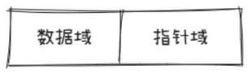
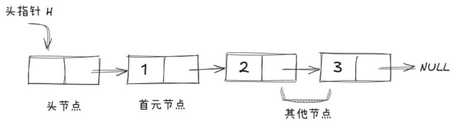
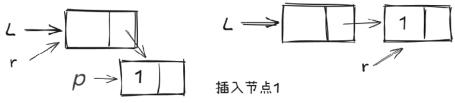
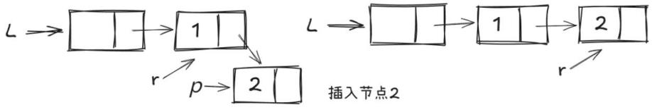
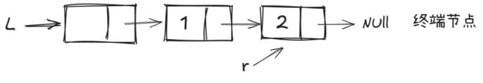
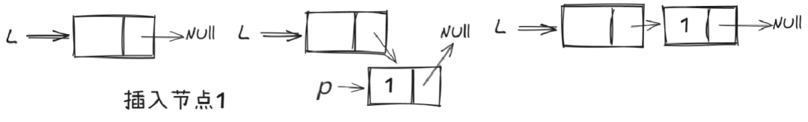
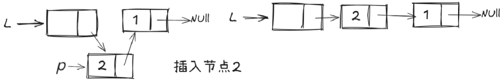

# 第 45 课：链表及其操作

链表的种类较多，这里我们主要讲解最常见的带头节点的单链表。

## 45.1 单链表

### 定义

单链表是一种常见的线性数据结构，它由一系列节点组成，每个节点包含数据元素和指向下一个节点的指针。

单链表中的节点通过指针连接成一条链，第一个节点称为头节点，最后一个节点的指针通常指向空，表示链表的结束。

如图 10-13 所示，链表中每个数据的存储都由以下两部分组成：

1) 数据元素本身，其所在的区域称为数据域；

2) 指向直接后继元素的指针所在的区域称为指针域。

图 10-13　链表节点



### 构成

1) 头节点：头节点是一个不存储任何数据的节点，主要是为了方便找到链表位置。

2) 首元节点：链表中第一个存有数据的节点，明确了链表中有效数据的起始位置，对链表的遍历、访问数据等操作，通常是从首元节点开始的。

3) 其他节点：除了头节点和首元节点之外的其他存储数据的节点。这些节点通过指针依次相连，每个节点都包含数据域和指针域，最后一个节点的指针域为 NULL，表示链表的结束。

举例：一个存储数据 {1, 2, 3} 的完整链表如图 10-14 所示。

图 10-14　链表

 

注意：链表中有头节点时，头指针指向头节点。若链表中没有头节点，则头指针指向首元节点。

简单来说，链表就像一环扣一环的链子一样，想插入或删除元素的时候，只需要找到你要插入或者删除的位置，然后解开该位置两边的环，将新的环连接上即可。

### 优缺点

链表的特殊结构决定了它拥有数组所没有的优势，那就是进行插入删除操作的时候，不需要移动元素。

但是它也有很明显的缺点：查找元素需要从头节点开始一个一个往后找，查找元素的时间复杂度相对较高。

所以如果随机访问和查找元素的操作较多，使用数组更合适；但如果数据动态变化频繁，需要频繁在任意位置进行插入操作，且对顺序访问有需求，链表则是更好的选择。

## 45.2 指针

在学习链表前，我们需要先简单了解一下指针。它本质上是一种变量，但存放的是内存地址，而非实际的数据值。

### 指针的定义

指针是一种数据类型，用来存储内存地址。指针变量在程序中通常被用来引用其他变量或对象的地址，从而修改或查询这些变量或对象。

### 指针的作用

1) 传递参数：指针可以用来传递参数，从而使函数能够修改调用者的变量值。

2) 动态内存分配：指针可以用来动态地分配内存，以创建数组或其他数据结构。

3) 实现数据结构：指针可以用来实现复杂的数据结构，如链表、树等。

### 指针的例子

在 C++ 中，指针使用 * 符号表示，例如：

```cpp
int a = 10; // 定义一个整型变量 a，并将其初始化为 10
int *p;     // 定义一个整型指针变量 p
p = &a;     // 指针 p 指向变量 a 的地址
```

在这个例子中，变量 a 存储了整数 10 的值，而变量 p 是一个整型指针，可以存储变量 a 的地址。通过 & 符号，我们可以获取变量 a 的地址，并将其赋给指针 p，从而使得指针 p 指向变量 a 所在的内存地址。

指针也可以通过 * 符号来访问指向的变量的值，例如：

```cpp
int b = *p; // 将指针 p 指向的变量的值赋给变量 b
```

在这个例子中，我们使用 * 符号来解析指针 p 所指向的地址，并取出其中存储的值，将其赋给变量 b。

### 注意事项

指针具有很大的潜在危险性，如果使用不当，可能会改变程序状态、造成内存泄漏或引起其他问题。因此，在使用指针的时候一定要谨慎，并遵循相应的规范和最佳实践。

## 45.3 单链表的相关操作

### 创建单链表

1) 定义节点结构：创建一个结构体来表示链表的节点，其中包含数据和指向下一个节点的指针。代码如下：

```cpp
struct Node
{
    int data;   // 保存节点中存储的数据
    Node *next; // 指向下一个节点
};
```

2) 创建头节点。

3) 插入节点：可以选择在链表头部、尾部或指定位置插入节点。

a. 头部插入：将新节点的指针指向当前头节点，然后更新头节点为新节点。

b. 尾部插入：遍历链表找到最后一个节点，将其指针指向新节点。

c. 指定位置插入：遍历到指定位置的前一个节点，然后调整指针将新节点插入。

### 尾插法插入元素

自定义函数 Wcreate 借助尾插法向链表里插入 n 个元素。尾插法的特点是新插入的元素总是位于链表的尾部，插入顺序与元素在链表中的存储顺序一致，具体操作见图 10-15、图 10-16、图 10-17。

图 10-15　尾插法插入节点 1



图 10-16　尾插法插入节点 2



图 10-17　终端节点



```cpp
struct Node
{
    int data;   // 保存节点中存储的数据
    Node *next; // 指向下一个节点
};
// 函数 Wcreate 使用尾插法向链表中插入 n 个元素
// 参数 l 是链表的头指针，参数 n 表示要插入的元素个数
void Wcreate(Node *l, int n)
{
    // 定义两个指针 p 和 r
    // p 用于创建新节点，r 用于指向链表的尾节点
    Node *p, *r;
    // 初始化 r 为链表的头节点 l，即让 r 指向链表的起始位置
    r = l;
    int k;
    for (int i = 0; i < n; i++) // 循环 n 次，每次插入一个新元素到链表尾部
    {
        cin >> k;
        // 使用 new 运算符动态分配一个新的 Node 节点，并让指针 p 指向它
        p = new Node;
        p->data = k; // 将 k 赋值给新节点 p 的 data 成员
        // 将当前尾节点 r 的 next 指针指向新节点 p，从而将新节点连接到链表尾部
        r->next = p;
        // 更新尾节点指针 r，让它指向新插入的节点 p，使 r 始终指向链表的尾节点
        r = p;
    }
    // 当插入 n 个元素后，将尾节点 r 的 next 指针置为 NULL，表示链表结束
    r->next = NULL;
}
```

### 遍历并显示链表内容

自定义 show 函数遍历并显示链表内容，具体操作如下：

```cpp
void show(Node *l)
{
    Node *p;
    p = l->next; // 让指针 p 指向链表的第一个节点
    // 当指针 p 不为空时，说明还未遍历到链表的末尾
    while (p != NULL)
    {
        cout << p->data << " "; // 输出当前节点 p 所存储的数据
        p = p->next;            // 将指针 p 移动到下一个节点
    }
    cout << endl;
}
```

### 头插法插入元素

自定义 Tcreate 函数通过头插法向链表中插入 n 个元素。头插法的特点是新插入的元素总是位于链表的头部，插入顺序与元素在链表中的存储顺序相反，具体操作见图 10-18、图 10-19。

图 10-18　头插法插入节点 1

 

图 10-19　头插法插入节点 2



```cpp
void Tcreate(Node *l, int n)
{
    Node *p;
    l->next = NULL;
    int k;
    for (int i = 0; i < n; i++)
    {
        cin >> k;
        p = new Node; // p 指向一个新节点
        p->data = k;  // 将 k 的值赋给新节点 p 的数据域
        // 让 p 的 next 指针指向当前头节点的下一个节点
        p->next = l->next;
        l->next = p; // 让头节点的 next 指针指向新节点 p
    }
}
```

### 向指定位置插入元素

自定义 insert 函数尝试在链表的指定位置 k 插入元素 e，具体操作如下：

```cpp
// k 是要插入元素的位置，e 是要插入元素的值
void insert(Node *l, int k, int e)
{
    Node *p, *r;
    r = l;
    if (r->next == NULL) // 检查链表是否为空
    {
        cout << "链表为空" << endl; // 若链表为空，输出提示信息
        return;
    }
    // 循环 k 次，让 r 指针移动到插入位置的前一个节点
    for (int i = 0; i < k; i++)
    {
        // 若 r 的 next 指针为 NULL，说明还未到达指定位置链表就结束了
        if (r->next == NULL)
        {
            cout << "位置超出链表长度" << endl; // 提示位置超出链表长度
            return;
        }
        r = r->next; // r 指针向后移动一个节点
    }
    p = new Node;
    p->data = e;       // 将需要插入的值 e 赋给新节点 p 的 data 成员
    p->next = r->next; // 让新节点 p 的 next 指针指向 r 节点的下一个节点
    r->next = p;       // 让 r 节点的 next 指针指向新节点 p
}
```

### 删除元素

自定义 Delete 函数用于在链表中查找值为 x 的第一个节点，并将其从链表中删除，具体操作如下：

```cpp
void Delete(Node *l, int x)
{
    Node *r, *pre;
    pre = l;
    r = l->next;
    // 遍历链表，同时检查 r 是否为 NULL
    while (r != NULL && r->data != x)
    {
        pre = r;
        r = r->next;
    }
    // 如果找到了要删除的节点（r 不为 NULL）
    if (r != NULL)
    {
        // 从链表中移除 r 节点
        pre->next = r->next;
        // 释放 r 节点的内存
        delete r;
    }
    else
    {
        // 若未找到要删除的节点，可根据需要进行提示
        cout << "未找到值为 " << x << " 的节点。" << endl;
    }
}
```

### 查找元素

自定义 Search 函数用于查找值为 x 的数是否存在，存在则输出第一次出现的位置，具体操作如下：

```cpp
void Search(Node *l, int x)
{
    int k = 1;
    Node *p;
    // 让指针 p 指向链表的第一个有效节点
    p = l->next;
    // 只要当前节点 p 的数据域不等于 x 且 p 的下一个节点不为空
    while (p->data != x && p->next != NULL)
    {
        // 将指针 p 移动到下一个节点
        p = p->next;
        // 节点序号 k 加 1，表示已经遍历到了下一个节点
        k++;
    }
    // 循环结束后，检查当前节点 p 的数据域是否等于 x
    if (p->data != x)
    {
        // 如果不等于 x，说明遍历完链表都没有找到要查找的元素
        cout << "未找到" << endl;
    }
    else
    {
        // 如果等于 x，说明找到了要查找的元素
        cout << "是第 " << k << "个数字" << endl;
    }
}
```

## 45.4 完整操作

```cpp
#include <iostream>
using namespace std;
struct Node
{
    int data;   // 保存节点中存储的数据
    Node *next; // 指向下一个节点
};
// 函数 Wcreate 使用尾插法向链表中插入 n 个元素
// 参数 l 是链表的头指针，参数 n 表示要插入的元素个数
void Wcreate(Node *l, int n)
{
    // 定义两个指针 p 和 r
    // p 用于创建新节点，r 用于指向链表的尾节点
    Node *p, *r;
    // 初始化 r 为链表的头节点 l，即让 r 指向链表的起始位置
    r = l;
    int k;
    for (int i = 0; i < n; i++) // 循环 n 次，每次插入一个新元素到链表尾部
    {
        cin >> k;
        // 使用 new 运算符动态分配一个新的 Node 节点，并让指针 p 指向它
        p = new Node;
        p->data = k; // 将 k 赋值给新节点 p 的 data 成员
        // 将当前尾节点 r 的 next 指针指向新节点 p，从而将新节点连接到链表尾部
        r->next = p;
        // 更新尾节点指针 r，让它指向新插入的节点 p，使 r 始终指向链表的尾节点
        r = p;
    }
    // 当插入 n 个元素后，将尾节点 r 的 next 指针置为 NULL，表示链表结束
    r->next = NULL;
}
void show(Node *l)
{
    Node *p;
    p = l->next; // 让指针 p 指向链表的第一个节点
    // 当指针 p 不为空时，说明还未遍历到链表的末尾
    while (p != NULL)
    {
        cout << p->data << " "; // 输出当前节点 p 所存储的数据
        p = p->next;            // 将指针 p 移动到下一个节点
    }
    cout << endl;
}
void Tcreate(Node *l, int n)
{
    Node *p;
    l->next = NULL;
    int k;
    for (int i = 0; i < n; i++)
    {
        cin >> k;
        p = new Node; // p 指向一个新节点
        p->data = k;  // 将 k 的值赋给新节点 p 的数据域
        // 让 p 的 next 指针指向当前头节点的下一个节点
        p->next = l->next;
        l->next = p; // 让头节点的 next 指针指向新节点 p
    }
}
void insert(Node *l, int k, int e)
{
    Node *p, *r;
    r = l;
    if (r->next == NULL) // 检查链表是否为空
    {
        cout << "链表为空" << endl; // 若链表为空，输出提示信息
        return;
    }
    // 循环 k 次，让 r 指针移动到插入位置的前一个节点
    for (int i = 0; i < k; i++)
    {
        // 若 r 的 next 指针为 NULL，说明还未到达指定位置链表就结束了
        if (r->next == NULL)
        {
            cout << "位置超出链表长度" << endl; // 提示位置超出链表长度
            return;
        }
        r = r->next; // r 指针向后移动一个节点
    }
    p = new Node;
    p->data = e;       // 将需要插入的值 e 赋给新节点 p 的 data 成员
    p->next = r->next; // 让新节点 p 的 next 指针指向 r 节点的下一个节点
    r->next = p;       // 让 r 节点的 next 指针指向新节点 p
}
void Delete(Node *l, int x)
{
    Node *r, *pre;
    pre = l;
    r = l->next;
    // 遍历链表，同时检查 r 是否为 NULL
    while (r != NULL && r->data != x)
    {
        pre = r;
        r = r->next;
    }
    // 如果找到了要删除的节点（r 不为 NULL）
    if (r != NULL)
    {
        // 从链表中移除 r 节点
        pre->next = r->next;
        // 释放 r 节点的内存
        delete r;
    }
    else
    {
        // 若未找到要删除的节点，可根据需要进行提示
        cout << "未找到值为 " << x << " 的节点。" << endl;
    }
}
void Search(Node *l, int x)
{
    int k = 1;
    Node *p;
    // 让指针 p 指向链表的第一个有效节点
    p = l->next;
    // 只要当前节点 p 的数据域不等于 x 且 p 的下一个节点不为空
    while (p->data != x && p->next != NULL)
    {
        // 将指针 p 移动到下一个节点
        p = p->next;
        // 节点序号 k 加 1，表示已经遍历到了下一个节点
        k++;
    }
    // 循环结束后，检查当前节点 p 的数据域是否等于 x
    if (p->data != x)
    {
        // 如果不等于 x，说明遍历完链表都没有找到要查找的元素
        cout << "未找到" << endl;
    }
    else
    {
        // 如果等于 x，说明找到了要查找的元素
        cout << "是第 " << k << "个数字" << endl;
    }
}
int main()
{
    Node *L; // 数据中第一个数字的位置是 0
    L = new Node;
    L->next = NULL;
    int n, x, m;
    cin >> n;
    Wcreate(L, n);
    cout << "尾插法插入结果：";
    show(L);
    //    Tcreate(L, n);
    //    cout << "头插法插入结果： ";
    //    show(L);
    //    cout << "请输入插入的位置及元素值： " << endl;
    //    cin >> m >> x;
    //    insert(L, m, x);
    //    show(L);
    //    cout << "请输入要删除的数值： " << endl;
    //    cin >> x;
    //    Delete(L, x);
    //    show(L);
    cout << "请输入要查找的数值：" << endl;
    cin >> x;
    Search(L, x);
    return 0;
}
```

输入：

```
5
1 2 3 4 5
```

运行输出结果：

```
尾插法插入结果：1 2 3 4 5
请输入要查找的数值：3
是第 3个数字
```

请尝试头插法、插入元素、删除元素等操作。
