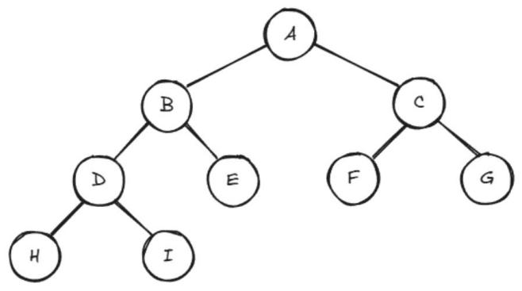
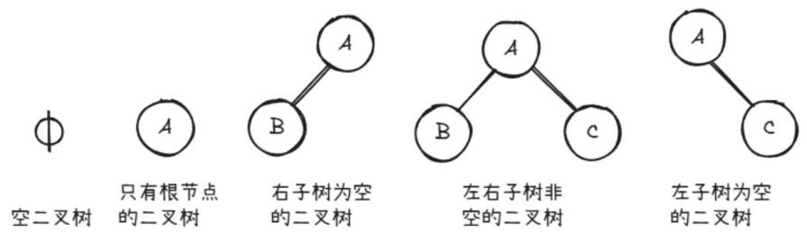
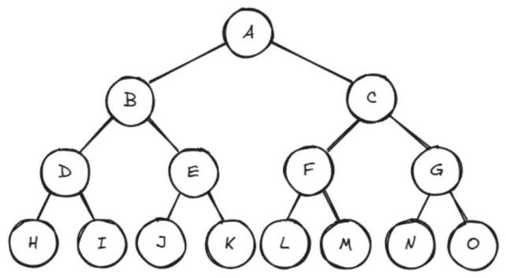
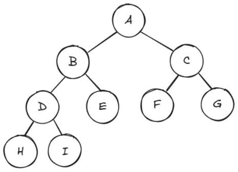
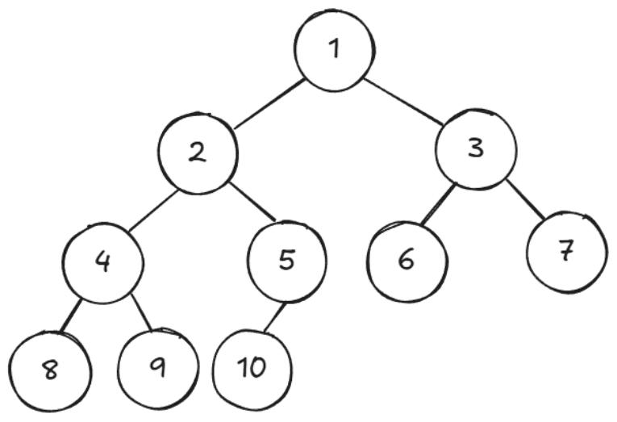
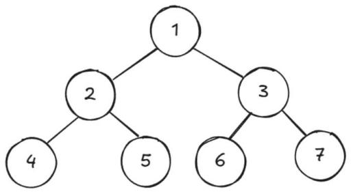
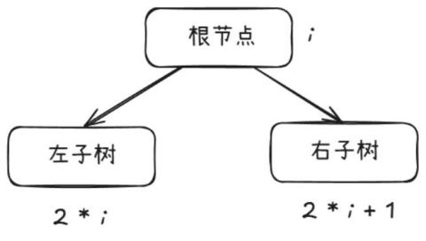

# 第 46 课：树及其应用

我们之前所学的数组、链表、栈及队列等知识都是线性的数据结构，而树则是一种非线性存储的数据结构，存储的是具有"一对多"关系的数据元素的集合。

树这种结构，我们在生活中常会见到。比如计算机的文件管理系统中有根目录，根目录下面包含各种子目录和文件，子目录又可以包含更多的子目录和文件。

家族族谱也是一种典型的树状结构，最早的一代延伸到下一代，下一代又延伸到下下一代，最终形成一棵家族树，清晰地展现了家族各个成员之间的血缘关系和辈分传承。

## 46.1 树的相关概念

以图 10-20 为例，这是一个树状结构。

图 10-20　树状结构



1) **节点**

树中的每一个数据元素都被称为"节点"。在图 10-20 中，数据元素 A、B、C……均是节点。

2) **父节点和子节点**

如果节点 A 与节点 B 有连接，且 A 在 B 的上一层，那么 A 是 B 的父节点，B 是 A 的子节点。对于图中的节点 A、B、C 来说，A 节点是 B、C 节点的父节点，而 B、C 节点都是 A 节点的子节点。

3) **兄弟节点**

具有相同父节点的节点互为兄弟节点。对于 B、C 节点来说，它们都有相同的父节点 A，所以它们互为兄弟节点；对于 D、E 节点来说，它们都有相同的父节点 B，所以它们也互为兄弟节点。

聪明的你，还能找到其他的兄弟节点吗？

4) **叶子节点**

没有子节点的节点称为叶子节点。H、I、E、F、G 节点都没有子节点，所以它们都是叶子节点。

5) **子树**

以某个节点为根的树的一部分称为一棵子树，子树中包括该节点及其所有后代节点。图中整棵树的根节点为节点 A，而节点 B、D、E、H、I 这 5 个节点也可以看作一棵树，节点 B 为这棵子树的根节点。

6) **节点的度**

拥有的子节点数称为节点的度。在图中，根节点 A 有 2 个子节点，所以，节点 A 的度为 2。

7) **树的度**

树中节点的最大子节点数为树的度。在图 10-20 中，除叶子节点外，其余节点的度均为 2，因此树的度也为 2。

8) **节点的层次**

从一棵树的树根开始，树根所在层为第一层，根的子节点所在的层为第二层，以此类推。在图中，A 节点在第一层，B、C 节点在第二层，D、E、F、G 节点在第三层，H、I 节点在第四层。

9) **树的深度**

一棵树的深度是树中节点所在的最大的层数。在图 10-20 中，树的深度为 4。

## 46.2 二叉树及其相关概念

### 定义

二叉树是一种特殊的树，二叉树的特点是每个节点最多有两个子节点。

### 二叉树的五种形态

如图 10-21 所示，根据二叉树定义得出五种形态。

图 10-21　二叉树的五种形态



### 二叉树的相关概念

1) **满二叉树**

如果每一层的节点数都达到最大值，即除最后一层无任何子节点外，每一层上的所有节点都有两个子节点，所有叶子节点必须在同一层上，这样的二叉树就是满二叉树，图 10-22 便是一棵满二叉树。

在同样高度的二叉树中，满二叉树的节点数目是最多的，叶子节点数也是最多的。

图 10-22　满二叉树



2) **完全二叉树**

设二叉树的深度为 h，除第 h 层外，其他各层（1 ～ h − 1）的节点数都达到最大个数，第 h 层所有的节点都集中在最左边，这样的二叉树就是完全二叉树，图 10-23 便是一棵完全二叉树。

图 10-23　完全二叉树



从定义可以看出：满二叉树一定是完全二叉树，完全二叉树不一定是满二叉树。

### 二叉树的性质

1) 性质一：在二叉树的第 i 层上至多有 2^(i−1) 个节点（i ≥ 1）。

2) 性质二：深度为 k 的二叉树至多有 2^k − 1 个节点。

3) 性质三：假设对一棵有 n 个节点的完全二叉树的节点按层序编号（从第一层开始到最下一层，每一层从左到右编号），如图 10-24 所示，图中共有 10 个节点。对任一节点 i，以下结论成立。

a. 如果 i = 1，则节点为根节点，没有父节点。

b. 如果 2i > n，则节点 i 没有左子节点，否则其左子节点为 2i。比如图 10-24 中对于节点 6 来说，2 × 6 > 10，节点 6 没有左子节点。对于节点 5 来说，2 × 5 > 10 不成立，则节点 5 有左子节点。

图 10-24　二叉树



c. 如果 2i + 1 > n，则节点 i 没有右子节点，否则其右子节点为 2i + 1。对于节点 5 来说，2 × 5 + 1 > 10，节点 5 没有右子节点；对于节点 4 来说，2 × 4 + 1 > 10 不成立，则节点 4 有右子节点，即节点 9。

## 46.3 二叉树的遍历

遍历一棵二叉树有四种方式，分别是先序遍历、中序遍历、后序遍历以及层次遍历。接下来我们以图 10-25 为例，一一介绍这四种方式。

图 10-25　遍历二叉树



### 先序遍历

二叉树先序遍历的实现思想如下。

1) 先访问根节点。图中最先访问的应该是节点 1。

2) 再访问当前节点的左子树。图中左子树为 2、4、5，应该先访问这棵子树的根节点 2，再访问这棵子树的左子树，只有一个节点 4。

3) 若当前节点无左子树，则访问当前节点的右子树。对于左子树 2、4、5 而言，访问完 4 之后，没有左子树，则应该访问其右子树 5。至此左子树访问结束，接下来应该访问右子树 3、6、7，继续按照根—左—右的顺序进行遍历，即访问顺序为节点 3、6、7。

由此，图 10-25 中二叉树采用先序遍历得到的序列为：**1 2 4 5 3 6 7**。

### 中序遍历

二叉树中序遍历的实现思想如下。

1) 先访问当前节点的左子树。图中左子树为 2、4、5，先访问它的左子树，只有一个节点 4。

2) 再访问根节点。当前子树的根是节点 2。

3) 最后访问当前节点的右子树。这棵子树的右子树只有一个节点 5，访问之。至此左子树访问结束，再访问整棵树的根，是节点 1，然后访问整棵树的右子树，按照上述规则，访问顺序应该是左—根—右，即访问顺序为节点 6、3、7。

由此，图 10-25 中二叉树采用中序遍历得到的序列为：**4 2 5 1 6 3 7**。

### 后序遍历

二叉树后序遍历的实现思想如下。

1) 先访问当前节点的左子树。图中左子树为 2、4、5，先访问它的左子树，只有一个节点 4。

2) 再访问当前节点的右子树。这棵子树的右子树只有一个节点 5。

3) 最后访问根节点。这棵子树的根是节点 2，访问之。至此左子树访问结束，继续访问整棵树的右子树，按照左—右—根的顺序，右子树的访问顺序为 6、7、3。最后再访问整棵树的根，是节点 1。

由此，图 10-25 中二叉树采用后序遍历得到的序列为：**4 5 2 6 7 3 1**。

### 层次遍历

二叉树层次遍历的实现思想是：按照二叉树中的层次从左到右依次遍历每层中的节点。

通常借助队列来实现该遍历方式，具体步骤如下。

1) 把根节点放入队列。

2) 当队列非空时：

a. 从队列中取出一个节点并访问；

b. 若该节点存在左子节点，将左子节点加入队列；

c. 若该节点存在右子节点，将右子节点加入队列。

由此，图 10-25 中二叉树采用层次遍历得到的序列为：**1 2 3 4 5 6 7**。

## 46.4 二叉树的建立

对于完全二叉树，我们可以使用数组来存储其节点值。

数组的下标和完全二叉树的节点之间存在一定的对应关系：若根节点的下标为 1，那么对于下标为 i 的节点，其左子节点的下标为 2i，右子节点的下标为 2i + 1。

比如图 10-26 中的这棵完全二叉树，对于节点 4 来说，它的左子节点为 2 × 4 = 8，它的右子节点为 2 × 4 + 1 = 9。对于节点 i 的关系见图 10-27。

图 10-26　完全二叉树


图 10-27　左右子树



下面我们通过数组实现完全二叉树的存储：

```cpp
#include <iostream>
using namespace std;
char h[1005];
string s;
int n, j;

// 通过先序遍历建立树
void Fcreate(int i)
{
    if (i > n)
        return;
    else
    {
        h[i] = s[j++];      // 存放节点数据
        Fcreate(i * 2);     // 建立左子树
        Fcreate(i * 2 + 1); // 建立右子树
    }
}

// 中序遍历
void inorder(int i)
{
    if (i > n)
        return;
    inorder(i * 2);     // 遍历左子树
    cout << h[i];       // 输出父节点
    inorder(i * 2 + 1); // 遍历右子树
}

// 后序遍历
void postorder(int i)
{
    if (i > n)
        return;
    postorder(i * 2);     // 遍历左子树
    postorder(i * 2 + 1); // 遍历右子树
    cout << h[i];         // 输出父节点
}

int main()
{
    cin >> s;
    n = s.size();
    Fcreate(1);
    cout << "中序遍历的结果为：";
    inorder(1);
    cout << endl;
    cout << "后序遍历的结果为：";
    postorder(1);
    return 0;
}
```

运行后输入（输入的是先序遍历的序列）：

```
1245367
```

运行结果：

```
中序遍历的结果为：4251637
后序遍历的结果为：4526731
```
