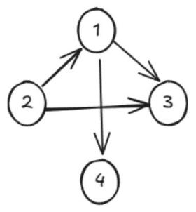
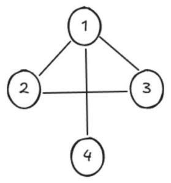
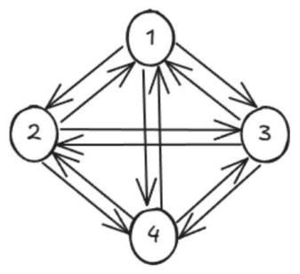
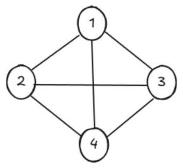
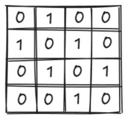
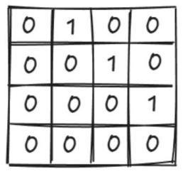
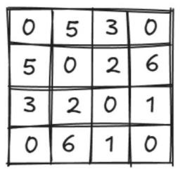

# 第 47 课：图及其应用

图也是我们在现实生活中会经常用到的一种数据结构，比如可以用社交网络图描述同学关系、好友关系、亲戚关系等。图也可以用来描述城市地铁等交通网络，还可以用来描述知识，比如用图来记录历史人物关系、事件等。

上述的图中，我们会画出一些点和线，用来描述多个元素之间多对多的关系，这也是本节所学的图的知识。

## 47.1 图的定义及相关概念

1) **图的定义**：图是由顶点（vertex）集合和边（edge）集合组成的数据结构，通常表示为 G = (V, E)，其中 G 表示一个图，V 是顶点的集合，E 是边的集合。

2) **顶点**：也称为节点，是图的基本组成单元，在社交网络中，顶点可以表示用户。

3) **边**：用于连接顶点，代表顶点之间的关系。边可以是有方向的，称为有向边；也可以是无方向的，称为无向边。

4) **有向图**：这类图中的边都是有方向的，只能按箭头方向从一点到另一点。

图 10-28 是一个有向图，V = {1, 2, 3, 4}，E = {<1, 3>, <1, 4>, <2, 1>, <2, 3>}。

图 10-28　有向图



5) **无向图**：这类图中的边都是没有方向的，两个顶点之间可以互相往来。

图 10-29 是一个无向图，V = {1, 2, 3, 4}，E = {(1, 2), (1, 3), (1, 4), (2, 3)}。

图 10-29　无向图



6) **完全有向图**：图中任意两个顶点之间，存在方向相反的两条边。

图 10-30 是一个完全有向图。n 个顶点的完全有向图有 n(n − 1) 条边，比如图 10-30 中共有 4 个顶点，则有 4 × 3 = 12 条边。

图 10-30　完全有向图



7) **完全无向图**：图中任意两个顶点之间存在一条边。

图 10-31 是一个完全无向图。n 个顶点的完全无向图有 n(n − 1)/2 条边，比如图中共 4 个顶点，则有 4 × 3 / 2 = 6 条边。

图 10-31　完全无向图



8) **稀疏图和稠密图**

a. 稀疏图：边数远远少于完全图的图。

b. 稠密图：边数接近完全图的图。

9) **顶点的度**

a. 无向图中：与顶点相连的边的数量叫作顶点的度。

b. 有向图中：以顶点为终点的有向边的数量叫作顶点的入度，以顶点为起点的有向边的数量叫作顶点的出度。

10) **权值**：边的"费用"，可以理解为边的长度。

## 47.2 图的存储

我们可以用邻接矩阵来存储图，它用一个二维矩阵来表示图中顶点之间的邻接关系。

### 无向图的邻接矩阵

对于一个具有 n 个顶点的无向图 G = (V, E)，其邻接矩阵 A 是一个 n × n 的矩阵。

如果顶点 vᵢ 和顶点 vⱼ 之间存在边，那么 A[i][j] = A[j][i] = 1；如果顶点 vᵢ 和顶点 vⱼ 之间不存在边，则 A[i][j] = A[j][i] = 0。无向图的邻接矩阵是一个对称矩阵，即 A[i][j] = A[j][i]。

例如，对于一个有 4 个顶点的无向图，顶点 v1 和 v2 相连，v2 和 v3 相连，v3 和 v4 相连，其邻接矩阵如图 10-32 所示。

图 10-32　无向图的邻接矩阵



### 有向图的邻接矩阵

对于具有 n 个顶点的有向图 G = (V, E)，其邻接矩阵 A 同样是一个 n × n 的矩阵。

如果存在从顶点 vᵢ 到顶点 vⱼ 的有向边，那么 A[i][j] = 1；如果不存在这样的有向边，则 A[i][j] = 0。与无向图不同，有向图的邻接矩阵不一定是对称矩阵。

例如，对于一个有 4 个顶点的有向图，存在从 v1 到 v2 的边，从 v2 到 v3 的边，从 v3 到 v4 的边，其邻接矩阵如图 10-33 所示。

图 10-33　有向图的邻接矩阵



### 带权图的邻接矩阵

对于带权图，邻接矩阵中的元素 A[i][j] 表示顶点 vᵢ 和顶点 vⱼ 之间边的权重。如果顶点 vᵢ 和顶点 vⱼ 之间不存在边，可以用一个特殊的值（如无穷大）来表示。

例如，对于一个有 4 个顶点的无向图，顶点 v1 和 v2 相连、权值为 5，v1 和 v3 相连、权值为 3，v2 和 v3 相连、权值为 2，v2 和 v4 相连、权值为 6，v3 和 v4 相连、权值为 1，其邻接矩阵如图 10-34 所示（这里不存在的边用 0 表示）。

图 10-34　带权图的邻接矩阵



### 邻接矩阵存图步骤

假设一个图共有 4 个顶点，并已给出两点之间的边（从 u 到 v 的有向边），将其存储至邻接矩阵的步骤如下。

1) 定义一个二维数组 g 作为邻接矩阵，用于存储图的信息，这里假设图的顶点数最多为 100 个。

2) 读取边的数量并更新邻接矩阵。

3) 输出邻接矩阵的内容。

代码如下：

```cpp
#include <iostream>
#include <cstring>
using namespace std;
int g[101][101];
int main()
{
    memset(g, 0x7f, sizeof(g)); // 先将数组初始化，赋一个极大值
    int n, u, v, num;
    cin >> n;
    // 读取边的信息并更新邻接矩阵
    for (int i = 1; i <= n; i++)
    {
        cin >> u >> v >> num; // 输入边的信息
        g[u][v] = num;
    }
    // 输出 4 个顶点的邻接矩阵
    for (int i = 1; i <= 4; i++)
    {
        for (int j = 1; j <= 4; j++)
            cout << g[i][j] << ' ';
        cout << endl;
    }
    return 0;
}
```

**输入**

```
4
1 2 3
2 3 5
3 4 7
```

**输出**

```
2139062143 3 2139062143 2139062143
2139062143 2139062143 5 2139062143
2139062143 2139062143 2139062143 7
2139062143 2139062143 2139062143 2139062143
```

> 注：原书输出样例跨页排版错乱（"2139062143 3 …"与"2139062143 …"各占一行、缺失第 4 行），此处已按 memset(0x7f) 即 INT_MAX 的取值规律补全 4 × 4 邻接矩阵。
