# 第 48 课：图的最短路径

最短路径问题是图论中的一个经典问题，旨在找到图中两点之间的最短路径。比如你想从当前位置回家，有三条路，应该怎么选择才能让路程更短呢？

于是你打开了地图导航应用，让它给你做规划。你发现有的路程最短、有的时间最短，而你当下想要的是快速回到家中，因此你自然会选择时间最短的那条路，时间便是你所要考虑的权值。

求最短路径的常见算法有 **Floyd（弗洛伊德）算法** 和 **Dijkstra（迪杰斯特拉）算法**。

## 48.1 Floyd 算法

Floyd 算法主要用于求解**多源最短路径**问题，它可以求出图中任意两点之间的最短距离。

它的基本思想是通过一个 n × n 的矩阵（n 为顶点数）来记录每对顶点之间的最短路径。算法会进行 n 次迭代，每次迭代都会尝试通过一个新的顶点来更新每对顶点之间的最短路径。

Floyd 算法的优点是实现简单，但该算法的时间复杂度较高，为 O(n³)，空间复杂度为 O(n²)。

假设我们现在要求出图 10-35 中任意两点之间的最短路径，通过 Floyd 算法来实现。

图 10-35　有向图图示

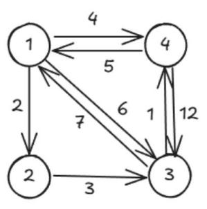

先用邻接矩阵 dt 存储此图（见图 10-36）。

图 10-36　邻接矩阵

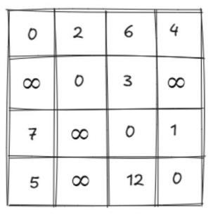

若要缩短两点之间的距离，只能通过引入其他的顶点来完成。

例如开始时 4→3 的距离 dt[4][3] 的值为 12，我们可以先引入顶点 1，让路线变成 4→1→3，这样距离就缩短成 dt[4][1] + dt[1][3] = 5 + 6 = 11，见图 10-37。

图 10-37　更新 dt[4][3]

![图 10-37 更新 dt[4][3]](img/image48_3.jpeg)   

引入顶点 1 之后，任意两点之间的最短距离更新，比如 3→2 本来是无穷大，现在可以 3→1→2，dt[3][2] = dt[3][1] + dt[1][2] = 7 + 2 = 9。同样 4→2 也是无穷大，引入顶点 1 后，可以 4→1→2，dt[4][2] = dt[4][1] + dt[1][2] = 5 + 2 = 7，邻接矩阵更新为图 10-38。

图 10-38　更新引入顶点 1 后的最短路径

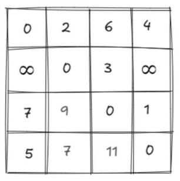

通过引入顶点 1，我们成功缩短了一些顶点之间的距离。如果再引入更多的顶点，会不会让距离变得更短呢？

比如在引入顶点 1 的基础上，再引入顶点 2，我们可以让 4→3 的值变得更小。已知现在 dt[4][3] = 11，若引入顶点 2，路线可为 4→2→3，则为 dt[4][2] + dt[2][3] = 7 + 3 = 10，又成功缩短了 4→3 的距离（见图 10-39）。

图 10-39　更新引入顶点 2 后的最短路径

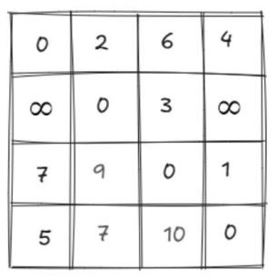

若想要得到 dt[4][3] 的最小值，我们只需分别引入顶点 1 到 n，取其中的最小值即可。以此类推，对于剩余的任意两点，我们都可以采用上述方法得到最短距离。

### 算法描述

1) 我们用 dt[i][j] 表示点 i 到 j 的最短路径，初始时各点到自身的距离均为 0，若无 i 到 j 的边，则为 inf（一个很大的值）。

2) 针对每个 dt[i][j]，我们依次引入顶点 1 到 n（用 k 表示），用来更新 dt[i][j] 的值，代码如下：

```cpp
if (dt[i][j] > dt[i][k] + dt[k][j]) // 若当前距离较大
    dt[i][j] = dt[i][k] + dt[k][j]; // 则更新最短路径
```

### 参考代码

```cpp
#include <iostream>
#define inf 999999999 // 定义无穷大常量
using namespace std;
int dt[101][101]; // 用于存储图中任意两点之间的最短距离
int main()
{
    int n, m, u, v, dis;
    cin >> n >> m; // 输入顶点数量 n 和边的数量 m
    for (int i = 1; i <= n; i++)
    {
        for (int j = 1; j <= n; j++)
        {
            // 如果是同一个顶点，距离为 0
            if (i == j)
                dt[i][j] = 0;
            // 不同顶点间距离初始化为无穷大，表示没有直接连接
            else
                dt[i][j] = inf;
        }
    }
    // 输入边的信息，更新邻接矩阵
    for (int i = 1; i <= m; i++)
    {
        // 输入边的起点 u、终点 v 和边的权重 dis
        cin >> u >> v >> dis;
        // 将边的权重存入邻接矩阵对应位置
        dt[u][v] = dis;
    }
    // Floyd 算法核心部分，用于计算任意两点之间的最短路径
    for (int k = 1; k <= n; k++)
    {
        // 遍历所有可能的起点 i
        for (int i = 1; i <= n; i++)
        {
            // 遍历所有可能的终点 j
            for (int j = 1; j <= n; j++)
            {
                // 如果经过中间点 k 能使 i 到 j 的距离更短
                if (dt[i][j] > dt[i][k] + dt[k][j])
                {
                    // 更新 i 到 j 的最短距离
                    dt[i][j] = dt[i][k] + dt[k][j];
                }
            }
        }
    }
    // 输出任意两点之间的最短距离矩阵
    for (int i = 1; i <= n; i++)
    {
        for (int j = 1; j <= n; j++)
        {
            cout << dt[i][j] << ' ';
        }
        cout << endl;
    }
    return 0;
}
```

**输入**（第一行输入顶点数量、边的数量，之后每行输入起点和终点以及两点的权值）：

```
4 8
1 2 2
1 3 6
1 4 4
2 1 1
2 3 3
3 1 7
3 4 1
4 1 5
4 3 12
```

> 注：原书输入样例跨页换行错乱（仅列了 6 条边，共 8 条），此处按图 10-35 完整补全 8 条有向边。

**输出**（任意两点之间的最短路径）：

```
0 2 5 4
9 0 3 4
6 8 0 1
5 7 10 0
```

> 注：原书输出样例跨页错乱（"0 2 5 4"、"9 0 3 4"、"6 8 0 1 5 7 10 0" 三行），此处按 4 × 4 矩阵重新排版。

## 48.2 Floyd 算法实例讲解

### 例 1：寻宝之路

蛙蛙正驾驶一条小艇在海上航行。海上有 N（1 ≤ N ≤ 100）个岛屿，用 1 到 N 编号。蛙蛙从 1 号小岛出发，最后到达 N 号小岛。

一张藏宝图上说，如果他经过的小岛依次出现了 A₁, A₂, …, A_M（2 ≤ M ≤ 10000）这样的序列（不一定相邻），最终就能找到古老的宝藏。

但是，海上有海盗出没。蛙蛙知道任意两个岛屿之间的航线上海盗出没的概率，他用一个危险指数 Dᵢⱼ（0 ≤ Dᵢⱼ ≤ 100000）来描述。

他希望他的寻宝活动经过的航线危险指数之和最小。那么，在找到宝藏的前提下，这个最小的危险指数是多少呢？

【输入格式】输入 N + M + 1 行。

第 1 行：输入两个用空格隔开的正整数 N 和 M。

第 2 行到第 M + 1 行：第 i + 1 行用一个整数 Aᵢ 表示蛙蛙必须经过的第 i 个岛屿。

第 M + 2 行到第 N + M + 1 行：第 i + M + 1 行包含 N 个用空格隔开的非负整数，分别表示 i 号小岛到第 1, …, N 号小岛的航线各自的危险指数，数据保证第 i 个数是 0。

【输出格式】输出一行，为蛙蛙在找到宝藏的前提下经过的航线的危险指数之和的最小值。

【输入样例】

```
3 4
1
2
1
3
0 5 1
5 0 2
1 2 0
```

> 注：原书输入样例跨页排版错乱（M + 2 行危险指数部分错位），此处按 3 × 3 完整矩阵补全。

【输出样例】

```
7
```

【说明】测试数据中 i 号岛到 j 号岛的危险指数不一定等于 j 号岛到 i 号岛的危险指数！

**解析**

样例分析

已知有 3 个岛屿（N = 3），必须经过的岛屿序列长度为 4（M = 4），序列为 1、2、1、3。岛屿间的危险指数如图 10-40 所示。

图 10-40　寻宝之路样例图

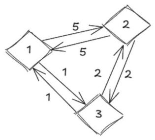

1) 首先，从 1 号岛出发，到达 A₁——1 号岛，危险指数为 0（因为是自己到自己）。

2) 接着，从 1 号岛出发，到达 A₂——2 号岛，根据 Floyd 算法可知，最小危险指数为 1 号岛 → 3 号岛 → 2 号岛的 3。

3) 然后，从 2 号岛出发，到达 A₃——1 号岛，根据 Floyd 算法可知，最小危险指数为 2 号岛 → 3 号岛 → 1 号岛的 3。

4) 最后，再从 1 号岛出发，到达 A₄——3 号岛，最小危险指数为 1。

5) 所以，总的最小危险指数为 0 + 3 + 3 + 1 = 7。

**参考代码**

```cpp
#include <iostream>
#include <algorithm>
using namespace std;
int dt[105][105];
int sx[10005];
int main()
{
    int n, m, ans = 0; // ans 用于存储最终的最小危险指数之和
    cin >> n >> m;     // 输入岛屿数量 n 和必须经过的岛屿序列长度 m
    for (int i = 1; i <= m; i++)
        cin >> sx[i];
    for (int i = 1; i <= n; i++)
        for (int j = 1; j <= n; j++)
            cin >> dt[i][j]; // dt[i][j] 表示从 i 号岛到 j 号岛的危险指数
    // Floyd 算法
    for (int k = 1; k <= n; k++)
        for (int i = 1; i <= n; i++)
            for (int j = 1; j <= n; j++)
                dt[i][j] = min(dt[i][j], dt[i][k] + dt[k][j]);
    // 遍历必须经过的岛屿序列
    for (int i = 1; i < m; i++)
        // 将相邻两个必须经过的岛屿之间的最小危险指数累加到 ans 中
        ans = ans + dt[sx[i]][sx[i + 1]];
    cout << ans;
    return 0;
}
```

## 48.3 Dijkstra 算法

Dijkstra 算法主要用于求解**单源最短路径**问题，它可以求出从起点 s（称为源点）到其余所有顶点的最短距离，仅适用于边权值非负的图。

这个算法的基本思想是维护一个已确定最短路径的顶点集合，初始时只包含源点，然后不断从集合外的顶点中选择距离源点最近的顶点加入集合，并更新其相邻顶点的最短距离估计值，直到所有顶点都被包含在集合中。

它的时间复杂度为 O(n²)，空间复杂度为 O(n²)（n 为顶点数），同样采用邻接矩阵存储。

在图 10-41 中，假设我们现在要以 1 作为起点，求它到图中所有顶点的最短路径，通过 Dijkstra 算法来实现。

图 10-41　Dijkstra 算法图示

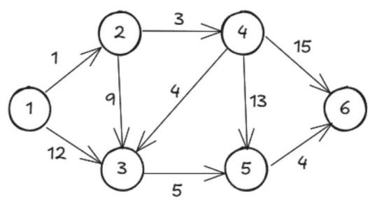

先用邻接矩阵 dt 存储此图（见图 10-42）。

图 10-42　邻接矩阵存储图

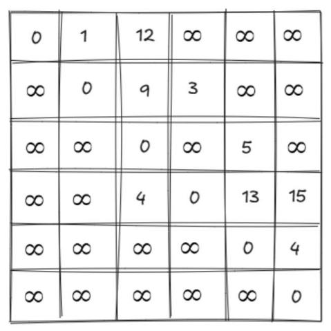

先使用一维数组 dis 存储起点 1 到各个顶点的距离，比如 dis[2] 表示 1 到 2 的距离。根据输入的边的信息初始化 dis 数组，其中顶点 1 到顶点 1 的距离为 0（见图 10-43）。

图 10-43　dis 数组存储起点 1 到各顶点的距离

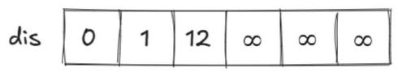

Dijkstra 算法的主要思想是贪心，我们可以先从 dis 数组中选出距离起点最近的顶点 2。

此时 dis[2] 的值已确定，因为 2 是距离起点 1 最近的顶点，并且其他边的长度都大于 0，无法将 dis[2] 的值缩小。

然后，再检查 2 的所有出边 2→3、2→4，观察能否通过这两条边，缩小 dis[3]、dis[4] 的值。

已知 dis[3] > dis[2] + dt[2][3]，所以 dis[3] 更新为 dis[2] + dt[2][3] = 10，这个过程叫作**松弛**。

同样，我们可以更新 dis[4] 的值，更新为 dis[2] + dt[2][4] = 1 + 3 = 4（见图 10-44）。

图 10-44　检查 2 的出边后更新 dis 数组

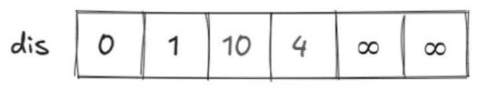

接下来，从剩余未使用过的顶点中，继续寻找距离起点最近的顶点（顶点 4），并更新它的出边到起点的距离（见图 10-45）。

图 10-45　检查 4 的出边后更新 dis 数组

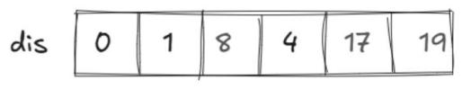 

重复上述过程，直至确定所有点的值。

### 算法描述

1) 初始化：为每个顶点分配一个距离值，源点的距离值设为 0，其他顶点的距离值设为无穷大。再根据已知信息，更新图中顶点到其他顶点的距离。

2) 迭代过程：对于顶点 u 的每个邻接顶点 v，计算从源点到 v 的距离值。如果经过 u 到达 v 的距离值小于 v 当前的距离值，则更新 v 的距离值。

详细描述见代码注释。

### 参考代码

```cpp
#include <iostream>
#define inf 999999999
using namespace std;
int dt[101][101]; // 用于存储图的邻接矩阵，记录顶点之间的边权值
int dis[100];     // 用于存储源点到各个顶点的当前最短距离
int used[100];    // 用于标记各个顶点是否已经被处理过
int main()
{
    // s 表示源点的编号，n 表示图中顶点的数量，m 表示图中边的数量
    // u 和 v 用于记录边的两个端点，d 用于记录边的权值
    // idx 用于记录当前找到的未使用过的最近顶点的编号，mn 用于记录最小距离
    int s, n, m, u, v, d, idx, mn;
    cin >> n >> m >> s; // 输入顶点数量 n、边的数量 m 和源点编号 s
    // 初始化邻接矩阵 dt
    for (int i = 1; i <= n; i++)
    {
        for (int j = 1; j <= n; j++)
        {
            // 如果是同一个顶点，边的权值为 0
            if (i == j)
                dt[i][j] = 0;
            // 不同顶点之间初始边权值设为无穷大，表示没有直接连接
            else
                dt[i][j] = inf;
        }
    }
    // 输入边的信息，更新邻接矩阵 dt
    for (int i = 1; i <= m; i++)
    {
        // 读取边的两个端点 u、v 和边的权值 d
        cin >> u >> v >> d;
        // 将边的权值存入邻接矩阵对应的位置
        dt[u][v] = d;
    }
    // 初始化源点 s 到各个顶点的距离数组 dis
    for (int i = 1; i <= n; i++)
        dis[i] = dt[s][i];
    // 标记源点 s 已经被处理过
    used[s] = 1;
    // 源点到自身的距离为 0
    dis[s] = 0;
    // Dijkstra 算法的核心部分
    for (int i = 1; i <= n; i++)
    {
        // 初始化最小距离为无穷大
        mn = inf;
        // 寻找未被处理过的顶点中，距离源点最近的顶点
        for (int j = 1; j <= n; j++)
        {
            if (!used[j] && dis[j] < mn)
            {
                mn = dis[j];
                idx = j;
            }
        }
        // 标记找到的最近顶点已经被处理过
        used[idx] = 1;
        // 对找到的最近顶点的所有邻接顶点进行松弛操作
        for (int j = 1; j <= n; j++)
        {
            // 如果存在从 idx 顶点到 j 顶点的边
            if (dt[idx][j] < inf)
                // 进行松弛操作，如果通过 idx 顶点到达 j 顶点的距离更短，则更新距离
                if (dis[j] > dis[idx] + dt[idx][j])
                {
                    dis[j] = dis[idx] + dt[idx][j];
                }
        }
    }
    // 输出源点到各个顶点的最短距离
    for (int i = 1; i <= n; i++)
        cout << dis[i] << ' ';
    return 0;
}
```

**输入**（顶点数量、边的数量和源点编号，接下来每行输入起点、终点及边权值）：

```
6 9 1
1 2 1
1 3 10
2 4 3
3 5 5
4 3 4
4 5 13
4 6 15
5 6 4
```

> 注：原书输入样例 9 条边跨页不全（仅列 5 条），此处按输出 `0 1 8 4 13 17` 补全验证。

**输出**（从源点到各个顶点的最短路径）：

```
0 1 8 4 13 17
```

## 48.4 Dijkstra 算法实例讲解

### 例 2：最先到达谷仓的母牛

蛙蛙在牧场体验生活，现在是母牛的晚餐时间，而母牛们还在外面的牧场中。

此时牧场主按响了电铃，所以它们开始向谷仓走去。

蛙蛙也分到了一项任务，他的工作是要指出哪头母牛会最先到达谷仓（在给出的测试数据中，总会有且只有一头最快的母牛）。在晚餐前，每头母牛都在它自己的牧场上，一些牧场上可能没有母牛。

每个牧场通过道路和一个或多个牧场连接（也可能与自己连接）。有时，两个牧场之间（也可能是同一个牧场与自己之间）会有超过一条道路相连。至少有一个牧场和谷仓之间有道路连接。

因此，所有的母牛最后都能到达谷仓，并且母牛总是走最短的路径。当然，母牛能向着任意方向前进，并且它们以相同的速度前进。

牧场被标记为 a~z 和 A~Y，在用大写字母表示的牧场中有一头母牛，小写字母中则没有。谷仓的标记是 Z，注意没有母牛在谷仓中，且 m 和 M 不是同一个牧场。

【输入格式】输入 P + 1 行。

第 1 行输入一个整数 P（1 ≤ P ≤ 10000），表示连接牧场（谷仓）的道路的数目。

第 2 行到第 P + 1 行，每行是用空格分开的两个字母和一个整数，字母是通过道路连接的牧场（包括谷仓）的名字，整数为道路的长度（1 ≤ 长度 ≤ 1000）。

【输出格式】输出一行，包含 2 个项目，分别表示最先到达谷仓的母牛所在的牧场，以及这头母牛走过的路径的长度。

【输入样例】

```
5
A d 6
B d 3
C e 9
d Z 8
e Z 3
```

【输出样例】

```
B 11
```

**解析**

样例分析

样例图示见图 10-46，先分析每头母牛到谷仓的最短路径。

图 10-46　最先到达谷仓的母牛样例图示

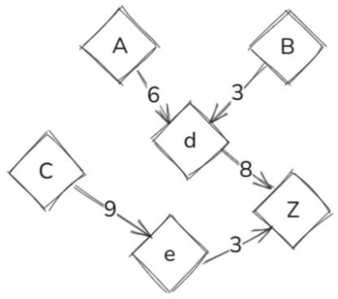

- 对于在牧场 A 的母牛：从 A 出发，要到达谷仓 Z，需要先从 A 到 d（距离为 6），再从 d 到 Z（距离为 8），所以总距离为 6 + 8 = 14。
- 对于在牧场 B 的母牛：从 B 出发，要到达谷仓 Z，需要先从 B 到 d（距离为 3），再从 d 到 Z（距离为 8），所以总距离为 3 + 8 = 11。
- 对于在牧场 C 的母牛：从 C 出发，要到达谷仓 Z，需要先从 C 到 e（距离为 9），再从 e 到 Z（距离为 3），所以总距离为 9 + 3 = 12。

因为 11 < 12 < 14，所以在牧场 B 的母牛会最先到达谷仓，且走过的路径长度为 11。

我们可以将每个牧场看作图中的一个顶点，道路看作边，道路的长度看作边的权值。

然后，我们可以使用 Dijkstra 算法来计算每头母牛所在牧场到谷仓的最短路径，最后找出最短路径中最短的那一条。

**参考代码**

```cpp
#include <iostream>
#define inf 999999999
using namespace std;
int dt[150][150]; // 存储各个点（A~z）之间的路径信息
int dis[130];     // 存储谷仓（Z）到各个点的当前最短距离
int used[130];    // 标记各个点是否已经被处理过
int main()
{
    // m 表示连接牧场（谷仓）的道路的数目
    // d 用于存储道路的长度
    // mn 用于在寻找未处理点中最小距离时暂存最小距离值
    // jl 用于记录目前找到的母牛所在点到谷仓的最短距离，初始化为无穷大
    int m, d, mn, jl = inf;
    // u 和 v 用于存储道路连接的两个点（牧场名）
    // idx 用于记录当前找到的未处理点中距离谷仓最近的点
    // ans 用于记录最终距离谷仓最近的母牛所在的牧场
    char u, v, idx, ans;
    // 初始化地图信息
    for (int i = 'A'; i <= 'z'; i++)
        for (int j = 'A'; j <= 'z'; j++)
            if (i == j)
                dt[i][j] = 0;
            else
                dt[i][j] = inf;
    // 输入连接牧场（谷仓）的道路的数目
    cin >> m;
    // 输入每条路径的信息，更新图的邻接矩阵
    for (int i = 1; i <= m; i++)
    {
        cin >> u >> v >> d;
        // 取较小值存储，避免重复边出现较大权重的情况
        dt[v][u] = dt[u][v] = min(dt[u][v], d);
    }
    // 初始化距离数组，将谷仓（Z）到各个点的距离设为邻接矩阵中对应的值
    for (int i = 'A'; i <= 'z'; i++)
        dis[i] = dt['Z'][i];
    // 标记谷仓（Z）已经被处理过
    used['Z'] = 1;
    // 谷仓到自身的距离为 0
    dis['Z'] = 0;
    // Dijkstra 算法
    for (int i = 'A'; i <= 'z'; i++)
    {
        // 初始化最小距离值为无穷大，用于寻找未处理点中距离谷仓最近的点
        mn = inf;
        for (int j = 'A'; j <= 'z'; j++)
        {
            // 寻找未被处理过且距离谷仓更近的点
            if (!used[j] && dis[j] < mn)
            {
                mn = dis[j];
                idx = j;
            }
        }
        // 在母牛所在点范围内寻找距离谷仓最近的点，更新 ans 和 jl
        if (dis[idx] < jl && idx >= 'A' && idx < 'Z')
        {
            ans = idx;
            jl = dis[idx];
        }
        // 标记找到的最近点已经被处理过
        used[idx] = 1;
        // 对找到的最近点的所有邻接边进行松弛操作，更新距离
        for (int j = 'A'; j <= 'z'; j++)
        {
            if (dt[idx][j] < inf)
                if (dis[j] > dis[idx] + dt[idx][j])
                    dis[j] = dis[idx] + dt[idx][j];
        }
    }
    // 输出距离谷仓最近的母牛所在点的标记和最短距离
    cout << ans << ' ' << jl;
    return 0;
}
```
